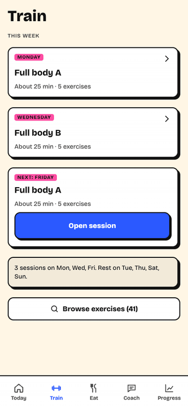

# Form & Flow

[](https://github.com/avinashgaurav/form-and-flow/actions/workflows/ci.yml)

A fitness and food coach for India. It plans training around your real week, logs Indian meals by typing (English or Hinglish) or by photo, and explains every change it makes. Photo logging needs the backend, which is not live yet ([#12](https://github.com/avinashgaurav/form-and-flow/issues/12)).



> [!NOTE]
> **Testing the AI coach.** I tested the coach on 27 fixed cases and ran the test 3 times, using Opus 5.5. The test found two wordings of a safety message that reached the AI instead of the fixed safety reply. It also found a checker rule that rejected nearly half the good replies. After the fixes: safety messages handled correctly went from 7/9 to **9/9**. Good replies wrongly flagged went from 23/47 to **4/47**. User figures repeated back and reaching the user went from 1 to **0**. Wrong numbers were 0/54 both times. I wrote the fixes after seeing these same cases, so treat the after-fix numbers as a best case. Details in [EVALS.md](EVALS.md).
>
> **On new cases** the code was never tuned on (40 cases, 3 runs): wrong numbers were 0/60, and good replies wrongly flagged were 7/56 (labelled by an AI reviewer, not yet confirmed by me). But the old safety word list (before the fix) caught only **1 of 14** real safety messages (crisis wordings 0/8, in English and Hinglish). After the safety fix, the same cases scored 20/20, with 1 of 26 other messages wrongly given a safety reply; that is a best case, because I wrote the fix after seeing them.
>
> **The safety fix.** It has two parts: a broader word list, and an AI safety screen that turns any answer other than a clear "none" (no safety issue), including an error or a timeout, into the fixed safe reply. On a fresh hidden set written before the fix (24 safety messages and 16 harmless lookalikes, 3 runs), all 24 got the right fixed reply, 0 reached the coach, and all 16 lookalikes were let through. But 17 of the 24 share wording with what the fix was tuned on. On the 7 that do not, the word list alone caught 1 and the AI screen caught the other 6.
>
> **What is live today.** The live app runs on the phone only: there is no backend yet, so no AI coach, no AI meal photos and no AI safety screen. The broader word list is live. The AI safety screen is built and tested but switched off until a backend exists ([#12](https://github.com/avinashgaurav/form-and-flow/issues/12); safety fix: [#8](https://github.com/avinashgaurav/form-and-flow/issues/8) (closed), [PR #9](https://github.com/avinashgaurav/form-and-flow/pull/9)). So users of the live app rely on the word list alone, and on the 7 fresh safety messages with wording the fix had not seen, it caught 1.
>
> **On Gemini** (the default AI since 2026-11-04), rerun on the same cases: the safety screen missed no safety message (24/24 on the fresh hidden set, 0 reached the coach), the same as on Claude. One coach reply out of 57 let a plan number through in the wrong meaning ("shorten to 33 minutes", the full session length). 74 of 316 safety checks took longer than the 4 seconds the app waits, which shows the fixed safe reply instead of an answer. The coach replies used the small "Fast" model; the default Gemini coach model is still untested (see EVALS.md).

**Live:** https://form-and-flow.vercel.app

- **iPhone:** open the link in Safari, tap Share, then "Add to Home Screen".
- **Android:** open the link in Chrome, tap ⋮, then "Install app".
- It opens full screen and works offline after the first visit. Data stays on that phone. Backup, sign-in and the AI features need a backend, which is not live yet ([#12](https://github.com/avinashgaurav/form-and-flow/issues/12)).

## What it does

| Tab | What you get |
|---|---|
| Today | Today's session or rest day, a 3-tap check-in, shorten the session when time is short |
| Train | The week's plan and a workout player: a looping 3D demo of every exercise, sets, rest timer, swaps, "something hurts" |
| Eat | Type, search or photograph a meal (photo logging needs the backend and is not live yet); check every item; calories and protein shown as honest ranges; usual meals in 2 taps |
| Coach | Answers from your plan's rules, with optional AI wording |
| Progress | Workouts per week, last 7 days of food against your guide, optional weight trend, strength history |

Settings covers setup, safety limits, reminders, the AI model choice, food preferences and allergies, backup, export and deletion.

## How it works

- **Code decides every number.** Plans, progression, safety screening and nutrition maths live in `@ff/engines` (pure TypeScript, tested). The AI only words coach replies and names foods in photos; the app checks every number the AI writes.
- **Safety first, in two layers.** Every message first goes through a safety word list in code (English, Hinglish and Hindi). A red-flag symptom, crisis message or eating-disorder signal it recognises gets a fixed response and reaches no AI at all. In builds with the AI safety screen turned on (a build flag, off until the server side is deployed and tested; see supabase/SETUP.md), and if you have allowed AI, every other message then goes to a small AI safety screen (Google's Gemini 3.5 Flash-Lite) before any coach answer, including the built-in rule answers. The screen may only pick one word from a fixed list (crisis, emergency, eating disorder, none). Anything other than a clear "none", including an error, a timeout or a malformed answer, gets the fixed safe reply. The AI never writes a safety reply, and the screen sees only the message text, not your profile or plan. Without AI consent, or when not signed in to the backup, only the word list runs. Plate-guidance mode hides every calorie number.
- **Which AI, and what it sees.** The AI provider is Google (Gemini) by default; the server's `AI_PROVIDER` setting (required) chooses between Google and Anthropic (Claude). Only messages and photos from users who allowed AI reach it: the text of each coach message the word list did not catch (to the safety screen, then, with a short plan summary and never your name or email, to word the reply) and meal photos you choose to send. The in-app notice names the provider, and if the provider changes, AI stays off until you agree to the new notice.
- **Local first.** Everything works on the phone. Backup to Supabase is optional and mirrors the phone, with row-level security on every table.
- **Food data.** Ingredient values come from USDA FoodData Central (SR Legacy, public domain); paneer and poha, Indian dish recipes and household portion sizes are our estimates, still under review.

## Run it

```bash
npm install
```

```bash
npm run web -w app
```

- **On your phone:** run `npm start -w app`, then scan the QR code with Expo Go (Android) or the Camera app (iPhone) on the same Wi-Fi.
- **All checks:** `npm run verify` runs the typechecks and the engine, database and app tests.
- **Real-AI check:** with your own `GEMINI_API_KEY` set in your terminal, `npm run ai:smoke` sends the server's exact safety screen, coach and photo requests to Gemini and checks the replies with the phone's validator (`AI_PROVIDER=anthropic` with `ANTHROPIC_API_KEY` checks the Claude path instead). Add `-- --photo path/to/meal.jpg` to test photo logging, or `-- --model claude-haiku-5-5` to try the Fast choice. It costs a few cents.
- **Web build:** `npm run build:web` (Vercel runs this on every push to `main`).
- **Exercise demos:** the 3D clips are rendered locally from a Mixamo character (raw files stay in the git-ignored `media-src/`). Start the `render-moves` server from `.claude/launch.json`, open `/batch?moves=<ids>`, then run `npm run moves:publish` to copy the clips into the app. Licences: [plan/25](plan/25-exercise-media-sources.md).
- **Server and phone builds:** see [supabase/SETUP.md](supabase/SETUP.md). The AI coach, photo logging and backup need your own Supabase project and a Gemini API key from a billing-enabled Google project (or an Anthropic key).

## Layout

| Path | Contents |
|---|---|
| `app/` | Expo app (React Native, Expo Router): screens, store, sync |
| `packages/engines/` | `@ff/engines`: planner, safety, nutrition, coach rules, progress maths |
| `supabase/` | Migrations, Edge Functions (coach, safety-screen, meal-photo, privacy), tests |
| `plan/` | Product plan: research, rules, screens, safety, privacy, scope |
| `design/` | Skin and icon options |
| `scripts/` | USDA value extraction, service worker build step |
| `evals/coach/` | Coach tests: test cases, the correct answers, the script that runs them, and results (see [EVALS.md](EVALS.md)) |
| `docs/` | Demo GIF |
| `tools/render-moves/` | Renders the exercise demos on your Mac (see Run it) |

## Status

Pilot build. Exercises, rules and recipes are drafts that no qualified coach or dietitian has reviewed yet. Form & Flow is a wellness coach, not medical advice and not a substitute for a doctor.

Crisis and emergency routing uses Indian numbers only (112, Tele-MANAS 14416). Outside India it will not give the right contact.

Issues are welcome; pull requests are not expected for now. To report a security problem, see [SECURITY.md](SECURITY.md).

## Licence

The code is MIT (see [LICENSE](LICENSE)). The exercise clips in `app/assets/exercises/` are not covered by MIT. They are rendered videos of a Mixamo character: 3 of the 46 motions are Mixamo motion capture and 43 are our own keyframes. The clips are used under [Adobe's Mixamo terms](https://helpx.adobe.com/creative-cloud/faq/mixamo-faq.html), and no raw Mixamo files are included. Details: [plan/25](plan/25-exercise-media-sources.md).
