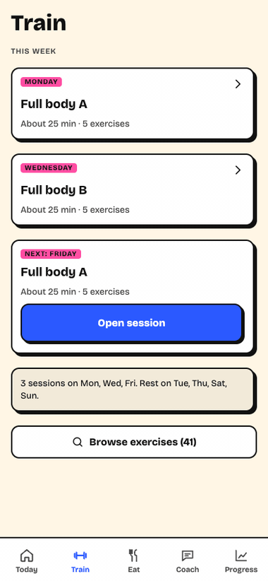

# Form & Flow

[](https://github.com/avinashgaurav/form-and-flow/actions/workflows/ci.yml)

A fitness and food coach for India. It plans training around your real week, logs Indian meals by typing (English or Hinglish) or by photo, and explains every change it makes.



> [!NOTE]
> **Testing the AI coach.** I tested the coach on 27 fixed cases and ran the test 3 times, using Opus 5.5. The test found two wordings of a safety message that reached the AI instead of the fixed safety reply. It also found a checker rule that rejected nearly half the good replies. After the fixes: safety messages handled correctly went from 7/9 to **9/9**. Good replies wrongly flagged went from 23/47 to **4/47**. User figures repeated back and reaching the user went from 1 to **0**. Wrong numbers were 0/54 both times. I wrote the fixes after seeing these same cases, so treat the after-fix numbers as a best case. Details in [EVALS.md](EVALS.md).

**Live:** https://form-and-flow.vercel.app

- **iPhone:** open the link in Safari, tap Share, then "Add to Home Screen".
- **Android:** open the link in Chrome, tap ⋮, then "Install app".
- It opens full screen and works offline after the first visit. Data stays on that phone unless you turn on backup.

## What it does

| Tab | What you get |
|---|---|
| Today | Today's session or rest day, a 3-tap check-in, shorten the session when time is short |
| Train | The week's plan and a workout player: a looping 3D demo of every exercise, sets, rest timer, swaps, "something hurts" |
| Eat | Type, search or photograph a meal; check every item; calories and protein shown as honest ranges; usual meals in 2 taps |
| Coach | Answers from your plan's rules, with optional AI wording |
| Progress | Workouts per week, last 7 days of food against your guide, optional weight trend, strength history |

Settings covers setup, safety limits, reminders, the AI model choice, food preferences and allergies, backup, export and deletion.

## How it works

- **Code decides every number.** Plans, progression, safety screening and nutrition maths live in `@ff/engines` (pure TypeScript, tested). The AI only words coach replies and names foods in photos; the app checks every number the AI writes.
- **Safety first.** Red-flag symptoms, crisis messages and eating-disorder signals get fixed responses, never AI. Plate-guidance mode hides every calorie number.
- **Local first.** Everything works on the phone. Backup to Supabase is optional and mirrors the phone, with row-level security on every table.
- **Food data.** Ingredient values come from USDA FoodData Central (SR Legacy, public domain); paneer and poha, Indian dish recipes and household portion sizes are our estimates, still under review.

## Run it

```bash
npm install
```

```bash
npm run web -w app
```

- **On your phone:** run `npm start -w app`, then scan the QR code with Expo Go (Android) or the Camera app (iPhone) on the same Wi-Fi.
- **All checks:** `npm run verify` runs the typechecks and the engine, database and app tests.
- **Real-AI check:** with your own `ANTHROPIC_API_KEY` set in your terminal, `npm run ai:smoke` sends the app's exact coach requests to Claude and checks the replies with the phone's validator. Add `-- --photo path/to/meal.jpg` to test photo logging, or `-- --model claude-haiku-5-5` to try another model. It costs a few cents.
- **Web build:** `npm run build:web` (Vercel runs this on every push to `main`).
- **Exercise demos:** the 3D clips are rendered locally from a Mixamo character (raw files stay in the git-ignored `media-src/`). Start the `render-moves` server from `.claude/launch.json`, open `/batch?moves=<ids>`, then run `npm run moves:publish` to copy the clips into the app. Licences: [plan/25](plan/25-exercise-media-sources.md).
- **Server and phone builds:** see [supabase/SETUP.md](supabase/SETUP.md). The AI coach, photo logging and backup need your own Supabase project and Anthropic API key.

## Layout

| Path | Contents |
|---|---|
| `app/` | Expo app (React Native, Expo Router): screens, store, sync |
| `packages/engines/` | `@ff/engines`: planner, safety, nutrition, coach rules, progress maths |
| `supabase/` | Migrations, Edge Functions (coach, meal-photo, privacy), tests |
| `plan/` | Product plan: research, rules, screens, safety, privacy, scope |
| `design/` | Skin and icon options |
| `scripts/` | USDA value extraction, service worker build step |
| `evals/coach/` | Coach tests: test cases, the correct answers, the script that runs them, and results (see [EVALS.md](EVALS.md)) |
| `docs/` | Demo GIF |
| `tools/render-moves/` | Renders the exercise demos on your Mac (see Run it) |

## Status

Pilot build. Exercises, rules and recipes are drafts that no qualified coach or dietitian has reviewed yet. Form & Flow is a wellness coach, not medical advice and not a substitute for a doctor.

Crisis and emergency routing uses Indian numbers only (112, Tele-MANAS 14416). Outside India it will not give the right contact.

Issues are welcome; pull requests are not expected for now. To report a security problem, see [SECURITY.md](SECURITY.md).

## Licence

The code is MIT (see [LICENSE](LICENSE)). The exercise clips in `app/assets/exercises/` are not covered by MIT. They are rendered videos of a Mixamo character: 3 of the 46 motions are Mixamo motion capture and 43 are our own keyframes. The clips are used under [Adobe's Mixamo terms](https://helpx.adobe.com/creative-cloud/faq/mixamo-faq.html), and no raw Mixamo files are included. Details: [plan/25](plan/25-exercise-media-sources.md).
