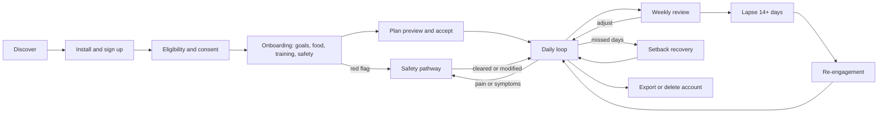
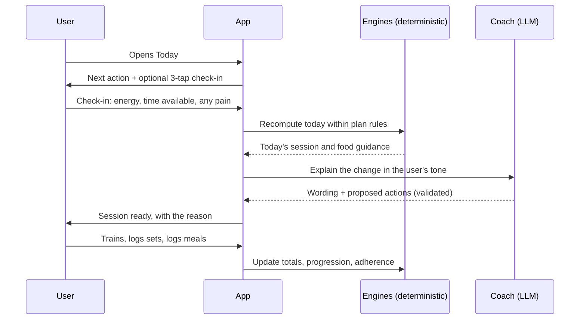
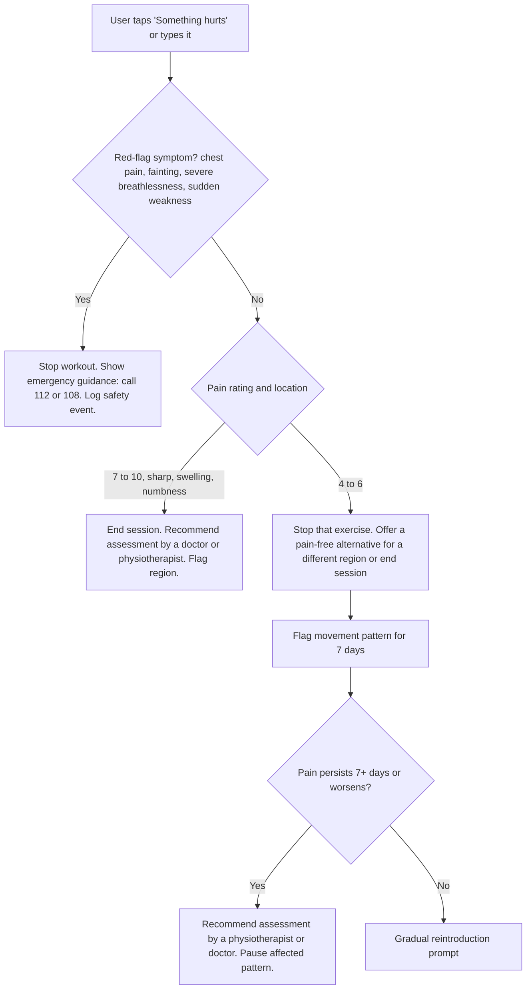

# 05 · Personas and journeys

Labels: **[FACT]** confirmed against a source in the claim register (file 02) · **[HYP]** hypothesis to test · **[REC]** recommendation · **[OPEN]** decision not yet made.

All personas are **[HYP]**. They come from desk research and the two earlier drafts, not from interviews. File 04 lists the interviews that will confirm or kill them.

---

## 1. Personas

### U0 · The founder-pilot (you)

| | |
|---|---|
| Role | First and only user for the first 4 weeks of real use |
| Job | "Prove the daily loop works on one real life before anyone else touches it." |
| Needs | Every number explained, every recommendation correctable, export and deletion that actually work, no fake precision |
| Success | Uses the app on at least 5 of 7 days for 4 weeks without reaching for another app to fill a gap |
| What U0 cannot prove | Effectiveness or safety for anyone else. A sample of one validates usability only. |

### U1 · The restarting beginner

| | |
|---|---|
| Snapshot | 26 to 40, desk job, metro city, often vegetarian or eggetarian household |
| Goal | Lose some fat, feel fitter, stop feeling lost in a gym |
| Constraints | 20 to 30 minutes, mostly at home, little equipment, low confidence |
| Past failure | Quit calorie apps because dal, sabzi and home rotis were missing or wrong, and logging took too long |
| Job to be done | "Tell me exactly what to do today, in a way I can actually finish." |
| Success signal | Completes 3 sessions a week for 4 weeks; can say why the plan looks the way it does |
| Risk to watch | Over-restriction after a "bad" day; body-image pressure |

### U2 · The gym regular who has stalled

| | |
|---|---|
| Snapshot | 21 to 32, trains 3 to 5 days a week, already logs sets somewhere |
| Goal | Muscle gain or strength |
| Constraints | Vegetarian or egg-only protein sources on a student or early-career budget |
| Past failure | Program-hopping; protein targets copied from Western content that do not fit Indian food or budgets |
| Job to be done | "Progress my lifts on a plan that adjusts, and help me hit protein with food I already eat." |
| Success signal | Logged top-set load or reps rise over 8 weeks; protein target met on most days |
| Risk to watch | Supplement over-reliance; training through pain |

### U3 · The time-poor professional or parent

| | |
|---|---|
| Snapshot | 32 to 48, travels or works shifts, eats out often |
| Goal | Consistency, energy, general fitness |
| Constraints | 15 to 30 minutes, unpredictable days, hotel rooms |
| Past failure | Rigid plans break on the first missed day and the backlog becomes guilt |
| Job to be done | "Give me a version of today that fits the time I actually have." |
| Success signal | No week with zero activity across 8 weeks; uses "I only have X minutes" and keeps going |
| Risk to watch | Unreported medical conditions in this age band (blood pressure, blood sugar) |

### U4 · The constrained household cook

| | |
|---|---|
| Snapshot | Cooks for a family; Jain, vegan, allergy, or fasting observances (Navratri, Ekadashi) |
| Goal | Eat better without cooking a separate meal |
| Constraints | Shared household meals, budget, religious and cultural rules |
| Past failure | Meal plans that ignore fasting days or assume ingredients the household never buys |
| Job to be done | "Fit healthier choices into the food my family already eats." |
| Success signal | Accepts most meal suggestions without edits; zero suggestions that break a stated rule |
| Note | Kokum, a separate product, may serve this persona better in a later bundle (file 24) |

### Out of scope for the MVP [REC]

| Group | Why | What the app does |
|---|---|---|
| Under 18 | India's data law treats under-18s as children needing verifiable parental consent (claim R-02); also a distinct safety profile | Blocks signup |
| Pregnant or within 12 months postpartum | Needs professionally reviewed programming | Logging and reviewed general education only; no training programme or nutrition targets |
| Current or past eating disorder | Calorie targets and weigh-ins can cause harm | Non-numeric mode only, plus support resources |
| Diagnosed heart, kidney or liver disease; any diabetes (insulin or sulfonylureas add extra limits); blood-pressure or heart-rhythm medicine; weight-loss medicine; told by a doctor to limit activity | Exercise and diet changes interact with treatment | Limited mode as defined in file 08 §4: logging and education until the user confirms medical clearance, then light-to-moderate training with no deficit |
| People wanting diagnosis, rehab or a medical diet | Out of product scope | Refer to a qualified professional |

---

## 2. Jobs to be done (ranked by hypothesis strength)

1. **Know what to do today** without planning it myself.
2. **Fit it into the time I have**, including bad days.
3. **Eat for my goal using food I already eat**, without exact weighing.
4. **See that it is working**, even when the scale is noisy.
5. **Recover from a missed week** without guilt or starting over.
6. **Trust the advice**: know why, know where it comes from, know it is safe.

---

## 3. Lifecycle journey

---

## 4. Key journeys

Each journey lists the trigger, what the user does, what the system does, and the failure that would break trust.

### J1 · First day: install to first completed action (target: under 15 minutes) [HYP]

| Step | User | System | Trust-breaking failure |
|---|---|---|---|
| 1 | Opens app from store | Welcome states what the coach does and does not do | Implied guaranteed results |
| 2 | Signs up | Email OTP or Google/Apple sign-in | Account enumeration in error text |
| 3 | Confirms 18+ and consents | Separate required and optional consents | Optional consent bundled with required |
| 4 | Onboarding (file 08) | Asks only what the chosen goal needs | Forcing weight entry for a habits goal |
| 5 | Sees plan preview | Shows the why, assumptions and time cost | A target with no explanation |
| 6 | Accepts | Today screen shows one next action | A dashboard of eight competing cards |
| 7 | Does a 10 to 20 minute starter session or logs one meal | Saves each set immediately | Lost sets after a phone call |

### J2 · The daily loop

### J3 · Weekly review

1. Sunday (user-chosen day) notification, if enabled.
2. Review shows **measured facts** (sessions done, sets logged, days with meals logged) separately from **estimates** (energy expenditure, trend weight).
3. Engine proposes at most two changes for next week, each with a reason and a source rule.
4. User accepts, edits, or declines each change. Declining is never penalised.
5. If data is insufficient, the review says so and proposes no change.

### J4 · Setback: missed 7 or more days, or travel

Shorter gaps simply resume the plan.

- No backlog. Missed sessions are marked missed, not stacked.
- Return session is a reduced-volume re-entry (rule-based; file 13).
- Copy is neutral: "Welcome back. Here is a shorter session to restart."
- Coach does not suggest compensatory restriction or extra cardio.

### J5 · Pain or symptoms during a workout

Emergency numbers are verified (claim R-22); the wording is pending professional review (file 14).

### J6 · Food log correction

- User logs "2 rotis, dal, bhindi" by text. Parser proposes items, portions and an uncertainty band.
- User edits the dal portion and oil level. Totals recalculate in code, not by the model.
- The correction is stored as a parse-accuracy signal (the Kokum `parsed` versus `confirmed` pattern).

### J7 · Plateau

- Trigger: trend weight flat for 3+ weeks on a fat-loss goal with adherence of at least 80 per cent on logged days, or no rep/load increase on a main lift for 3 sessions.
- System first checks data quality (logging gaps), then offers options: hold, small adjustment within bounds, or a deload. Never an automatic cut below the floor in file 13.

### J8 · Eating-disorder risk signals

- Signals: user asks for very low calorie targets, reports purging, fasting to compensate, or distress about food; repeated deletion of logged meals.
- System switches to the reviewed supportive response, removes numeric targets from view, offers to turn off calorie display, and shows support resources. Logged in the restricted safety table, not analytics.

### J9 · Account deletion

1. Settings, Privacy, Delete account. Explains what is deleted, what is retained by law, and the timeline.
2. Re-authentication, then confirmation.
3. Status screen; confirmation email when complete.
4. Deletion covers database, storage, analytics identifiers, AI provider (where retention applies), push tokens and exports. Security logs without content are kept for one year as the DPDP Rules require, then erased (file 15 §3a).

### J10 · Re-engagement after a lapse of 14+ days

- At most one notification, and only if the user opted in. No guilt, no streak-loss messaging.
- On return: "Start where you are" re-check of time, equipment and any new pain, then a fresh week.
- Old plan archived, not deleted; history remains.
