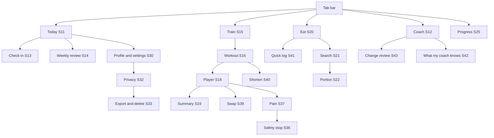

# 07 · Complete screen inventory

47 screen and sheet IDs (S01 to S46 plus S06b), all P0 except S35 (P2). IDs S01 to S35 keep the numbering from the Phase 2 draft; S36 to S46 are new and fill gaps that draft left (safety stop, pain flow, swap, memory viewer, sync conflicts and others).

Priority: **P0** pilot MVP · **P1** beta · **P2** launch or later. Everything here is **[REC]** unless marked.

---

## 1. Global rules every screen inherits

These are written once and apply everywhere. A screen spec only lists what differs.

| Rule | Behaviour |
|---|---|
| G-LOAD | Skeletons only where layout is predictable (lists, cards). Spinners only for actions under 2 s. Over 2 s: show what is happening ("Building your week"). Over 10 s: offer to wait or continue with the last saved plan. |
| G-EMPTY | Every list has a first-use empty state with one clear action. Never a blank screen. |
| G-ERR | Inline field errors next to the field, in words, not codes. Full-screen error only when nothing can render; always with Retry and a trace ID in small text. |
| G-OFF | Offline banner at top. Logging still works and queues. Coach and plan generation show "needs connection" with what still works. |
| G-SYNC | Each logged item shows a quiet sync mark: saved on phone, synced, or failed (tap to retry). Never show "saved" before the local write succeeds. |
| G-AUTH | Expired session: keep unsynced local data, re-authenticate in a sheet, then resume. Never discard queued logs on sign-out without warning. |
| G-UNDO | Deletes of user data show a 5-second undo toast; account-level destructive actions need typed or re-auth confirmation instead. |
| G-SAFE | A "Something's wrong?" entry is reachable from the workout player and the coach at all times. |
| G-A11Y | Every interactive element has a role and label; touch targets at least 44 pt (iOS) and 48 dp (Android) (claim R-23); text scales to 200 per cent without clipping primary actions; reading order matches visual order; no information by colour alone; reduced motion respected. |
| G-L10N | All strings externalised; layouts tolerate 40 per cent text expansion; numbers and dates use locale formats; units follow the user setting. |
| G-NUM | Any estimated number shows "about" or a range and a tap-through to "how we got this". Measured numbers do not. |

---

## 2. Acquisition, account and consent

| ID | Screen | Purpose and content | Screen-specific states | Validation and edge cases | Pri |
|---|---|---|---|---|---|
| S01 | Welcome | What the coach does and does not do; sample coach exchange; Sign up; Sign in; Terms and Privacy links | First visit; returning (go to sign-in); offline (content cached; sign-up disabled with reason); maintenance banner | No outcome promises in copy (file 14, claims review) | P0 |
| S02 | Sign up / sign in | Email field, Send code; OTP entry (6 digits); Google and Apple buttons (P1) | Sending; code sent (resend after 30 s); wrong code; expired code; too many attempts (lock 15 min) | Email format check; same response whether or not the email exists; paste of OTP supported; 5 attempts per code | P0 |
| S03 | Eligibility and consent | Date of birth; required consent (core processing, with plain summary and full notice link); explicit AI-processing consent naming the provider (if declined: coach chat and text parsing off, everything else works); optional toggles per file 15 §4 | Under 18: blocked screen, no data kept beyond the refusal event; consent version changed later: re-prompt on next open | DOB must give age 18 to 100; required consent cannot be pre-ticked; optional toggles default off | P0 |

---

## 3. Onboarding (detail in file 08)

| ID | Screen | Purpose and content | Screen-specific states | Validation and edge cases | Pri |
|---|---|---|---|---|---|
| S04 | Goal | Primary goal (single select from 7); up to 2 secondary | Changing primary later resets plan proposal, not history | Secondary cannot duplicate primary; fat loss plus muscle gain allowed (recomposition) with an explanation | P0 |
| S05 | Baseline | Height, weight (optional unless numeric fat-loss or gain mode), sex for energy equations (with "prefer not to say" path), activity level, training experience | Weight skipped: numeric energy targets disabled with explanation | Height 120 to 220 cm; weight 30 to 250 kg; implausible BMI (under 15 or over 60) asks to confirm, not reject; unit toggle converts without rounding loss | P0 |
| S06 | Readiness screening | Reviewed questions (file 08 §4) | Any "yes": go to S06b; "not sure": treated as yes for the specific item | Cannot skip; answers stored in restricted table | P0 |
| S06b | Safety pathway result | Plain explanation of which features are limited and why; what to do next; option to continue in limited mode | Red-flag symptom today: emergency guidance first (S36) | No diagnosis language; no "you are fine" language | P0 |
| S07 | Food profile | Pattern; allergies (multi-select plus free text, mapped to allergen tags); dislikes; cuisines; budget band; cooking access (cook, someone cooks, mostly eat out); numeric or non-numeric mode | Free-text allergy not mapped: kept as a hard text exclusion and flagged for review | Allergy list cannot be empty if "I have allergies" is ticked; Jain implies no root vegetables (confirm with user) | P0 |
| S08 | Training profile | Location (home, gym, both); equipment checklist; days per week; session length; preferences (exercises to avoid) | No equipment: bodyweight library only | 1 to 7 days available; the engine schedules at most 6 sessions (TR-10) and aims for at least 2 (TR-01); length 10 to 120 min | P0 |
| S09 | Coaching preferences | Tone (direct, gentle, data-first); check-in time; reminder categories with OS permission primer | OS permission denied: app works; settings link shown once | Quiet hours default 22:00 to 07:00 | P0 |
| S10 | Plan preview | Week view, sessions, food guidance, habits, assumptions, reasons; Accept, Edit constraints, Regenerate | Generating (G-LOAD long form); generation failed: retry or start with a starter template; limited mode banner if S06b applied | Regenerate max 5 a day; edits re-run engines, not the model | P0 |

---

## 4. Home and coaching

| ID | Screen | Purpose and content | Screen-specific states | Validation and edge cases | Pri |
|---|---|---|---|---|---|
| S11 | Today | Greeting; one next action card; today's session card; food summary; habits; check-in prompt; weekly progress strip | First day; rest day ("Rest is part of the plan"); session done; partial; missed yesterday (no backlog); plan unavailable (cached plan shown); offline | Date boundary uses the user's timezone; late-night logging (before 04:00) asks which day it belongs to | P0 |
| S12 | Coach | Messages; suggested prompts; action cards (Confirm / Not now); source chips; thumbs and report | Streaming; slow (over 8 s: "still thinking", cancel); timeout; model unavailable (canned helpful fallback + logging links); safety response (styled distinctly); rate limited | Message max 2,000 characters; images not accepted in MVP; actions expire after 24 h | P0 |
| S13 | Daily check-in (sheet) | Three taps: energy (1 to 5), time today (preset chips), any pain (no, yes) | Pain yes: S37; energy 1: offer lighter session or rest | Dismissable; never blocks Today | P0 |
| S14 | Weekly review | Measured facts; estimates with ranges; up to 2 proposed changes with reasons; accept or decline each | Insufficient data: says so, proposes nothing; first week: "next review after 7 days of use" | Declined changes not re-proposed for 2 weeks | P0 |
| S42 | What my coach knows | Stable preferences, goals, constraints, short-term notes with expiry; edit, delete | Empty: explains what will appear | Deleting an item removes it from future prompts within one request | P0 |
| S43 | Plan change review | Before and after of a proposed change; reason; rule ID; source; Accept or Decline | Change already superseded: shown as expired | Accept is idempotent | P0 |
| S46 | Evidence card | Plain summary, who it applies to, limits, source with date, review date | Card retired: shows "this guidance was updated" with the new card | | P0 |

---

## 5. Training

| ID | Screen | Purpose and content | Screen-specific states | Validation and edge cases | Pri |
|---|---|---|---|---|---|
| S15 | Week schedule | 7-day strip; sessions; rest days; move or skip | Move would put 2 sessions on one day: warn; skipping all: neutral note | Moving never increases weekly volume | P0 |
| S16 | Workout overview | Warm-up, exercises, sets x reps or time, rest, equipment, estimated duration; Start; Shorten | Missing media for an exercise: text cues shown, badge "video coming" | Equipment mismatch never shown (engine guarantees) | P0 |
| S17 | Exercise detail | Demo media; setup; 3 to 5 cues; common mistakes; easier and harder versions; muscles worked | Media buffering; media failed (text remains); offline (cached thumbnails only) | Captions on all video | P0 (text + image), P1 (video) |
| S18 | Workout player | Current exercise; set rows (target, actual reps, load, effort as reps in reserve 0 to 5, optional); rest timer; swap; skip; "Something's wrong?" | App backgrounded: timer continues with local notification; phone call: state preserved; force quit: resume prompt on reopen; double tap on Done: one set saved | Reps 0 to 100; load 0 to 500 kg (step 0.5); duration 1 s to 2 h; effort optional | P0 |
| S19 | Workout summary | Completed sets; skipped; volume; "how did that feel" (too easy, right, too hard); note | Partial session: saved as partial | No calories burned shown; personal bests only from logged data | P0 |
| S36 | Safety stop | Full-screen; calm wording; emergency number; "I'm OK now" exits to rest-day mode, not back into the workout | Shown from check-in, player, coach or onboarding | Cannot be dismissed by swipe; logged as a safety event | P0 |
| S37 | Pain report | Where (body map, accessible list alternative); how bad (0 to 10); when (during, after, constant); red-flag questions | Red-flag yes: S36; 7+ on scale: end session and suggest assessment; otherwise swap or end | Body map has a list alternative for screen readers | P0 |
| S38 | Exercise library | Search and filter by pattern, equipment, level | No results: suggest removing a filter | Search tolerates spelling ("squat", "sqaut") | P0 |
| S39 | Swap exercise (sheet) | Up to 3 alternatives that match pattern, equipment and pain flags | None available: offer to skip, never invent one | Swap applies to this session or the rest of the block (user choice) | P0 |
| S40 | Shorten session (sheet) | "I have 10 / 15 / 20 / 30 min"; shows what is kept and what is cut | Below 10 min: offers a mobility or walk option | Keeps the main lift or the session's purpose; never raises intensity to compensate | P0 |

---

## 6. Nutrition

| ID | Screen | Purpose and content | Screen-specific states | Validation and edge cases | Pri |
|---|---|---|---|---|---|
| S20 | Nutrition today | Meal timeline; targets as ranges (numeric mode) or plate guidance (non-numeric); protein and fibre; logged versus estimated split | Nothing logged; partial day; non-numeric mode hides all calorie numbers app-wide | Day boundary as S11 | P0 |
| S41 | Quick log (text) | One text box: "2 roti, dal, bhindi"; parse result as editable rows with portion and oil level; Save | Parsing; parse failed (falls back to search with the words prefilled); unknown item (kept as unmatched, user picks or skips) | Max 500 characters; nothing saved until the user taps Save | P0 |
| S21 | Food search | Search; recent; saved meals; filters | No results: suggest an alias or "add as custom food" | Matches aliases and Hinglish; excludes allergens from suggestions but still lets the user log what they actually ate, with a warning | P0 |
| S22 | Food detail and portion | Portion units (katori (bowl), piece (roti, idli and similar), tbsp, tsp, cup, glass, g, ml); quantity stepper; oil level; preparation; source and licence; uncertainty note | Missing nutrient values: shown as "not available", never zero | Quantity over 0 and up to 5,000 g; steps of 0.25 for household units | P0 |
| S23 | Meal builder | Combine items; save as meal or recipe; servings | Recipe edited later: past logs unchanged | Recipe yield 1 to 20 servings | P0 |
| S24 | Meal history | Edit, duplicate, move, delete logged meals | Edit conflict from another device: S44 | Moving a meal across midnight recalculates both days | P0 |

---

## 7. Progress

| ID | Screen | Purpose and content | Screen-specific states | Validation and edge cases | Pri |
|---|---|---|---|---|---|
| S25 | Progress overview | Consistency; selected trends; milestones | Fewer than 7 days of data: "trends appear after a week" | No projections of future weight | P0 |
| S26 | Weight and measurements | Raw entries plus smoothed trend; add, edit, delete | Weight not tracked: hidden entirely; gaps: trend line breaks, not interpolated over 7+ days | Duplicate same-day entries: keep both, use the latest, show both in history | P0 (weight), P1 (measurements) |
| S27 | Strength history | Per-exercise chart of top set and estimated volume; personal bests from logged data | One session only: no chart, list instead | Unit change re-renders without data change | P0 |
| S28 | Habit history | Calendar of habits; rest days shown as rest, not failure | | No streak counters in MVP | P0 |

---

## 8. Settings, privacy, support

| ID | Screen | Purpose and content | Screen-specific states | Validation and edge cases | Pri |
|---|---|---|---|---|---|
| S29 | Plan editor | Goals, days, equipment, session length; shows the effect before saving | Change mid-week: applies from tomorrow | Same bounds as onboarding | P0 |
| S30 | Profile and preferences | Name, units, timezone, diet, allergies, coaching style, nutrition mode | Timezone change detected: ask to update | Allergy removal needs confirmation | P0 |
| S31 | Notifications | Categories, times, quiet hours, pause all | OS permission off: explain and link to settings | | P0 |
| S32 | Privacy centre | Consents with history; what we store and why; connected services; export; delete | | | P0 |
| S33 | Export and delete | Request export (status, download link valid 24 h); delete account (re-auth, explanation, status) | Export failed: retry; deletion pending: sign-out with status email | Re-auth required for both | P0 |
| S34 | Help and report | Report wrong food data, unsafe advice, bug, account issue; FAQ | Offline: report queued | Attaches app version and trace ID, never health data without consent | P0 |
| S35 | Subscription | Plans, price, renewal, restore, cancel guidance | Store purchase failed or pending; entitlement mismatch | Hidden until monetisation is approved | P2 |
| S44 | Sync and conflicts (sheet) | Lists items that failed or conflicted; keep mine, keep other, keep both (logs only) | | Conflicts never silently dropped | P0 |
| S45 | Welcome back | After 14+ days away: quick re-check of time, equipment, pain; fresh week | | No guilt copy | P0 |

---

---

## 9. Navigation map

Profile and settings sit behind the avatar on Today, not in the tab bar.
