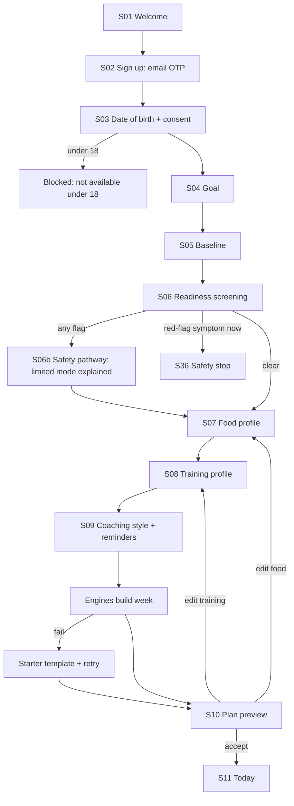

# 08 · Detailed onboarding flow

Target **[HYP]**: median under 6 minutes from consent to plan preview, 11 steps, every step resumable. Every field says why it is asked.

## 1. Flow

## 2. Step-by-step specification

| # | Step | Fields | Required | Validation | Why we ask (shown to user) | Branching |
|---|---|---|---|---|---|---|
| 1 | Welcome | none | | | | |
| 2 | Account | Email; OTP | Yes | Email syntax; 6-digit code; 5 tries; resend after 30 s | "So your plan and logs are saved and recoverable." | Existing account: signs in silently, resumes onboarding where it stopped |
| 3 | Eligibility and consent | Date of birth; required consent; optional consents | DOB and required consent | Age 18 to 100 | "This app is for adults. We ask once and do not show your age to anyone." | Under 18: blocked, no profile created |
| 4 | Goal | Primary (one of 7); secondary (up to 2) | Primary | Secondary not equal to primary | "Your goal decides how your week is built." | Non-weight goal: weight becomes optional |
| 5 | Baseline | Height; weight; sex for energy equations or "prefer not to say"; activity level (4 options with examples); training experience (none, under 6 months, 6 to 24 months, 2+ years) | Height and activity; weight only for numeric weight goals | Height 120 to 220 cm; weight 30 to 250 kg; confirm if BMI under 15 or over 60 | "Used to estimate your energy needs. Estimates improve as you log." | "Prefer not to say" uses the average of both equations and widens the range |
| 6 | Readiness | 10 questions (§4) | Yes, all | Yes / No / Not sure | "A few safety questions so we never suggest something risky for you." | Any flag: step 6b. Red flag now: safety stop. |
| 6b | Safety pathway | Explanation of limits; acknowledgement | Acknowledge | | "Here is what we will and will not do for you, and why." | Continue in limited mode, or exit |
| 7 | Food profile | Pattern; allergies; dislikes; cuisines; budget band (4 bands); who cooks; numeric or non-numeric mode | Pattern and allergy yes/no | Allergy yes requires at least one entry | "Allergies are never broken. Dislikes we avoid where we can." | ED flag from step 6 forces non-numeric mode |
| 8 | Training profile | Home / gym / both; equipment checklist; days per week; session length; exercises to avoid | Location, days, length | 1 to 7 days available (engine schedules 2 to 6 sessions where possible); length 10 to 120 min | "We only plan with what you have and the time you have." | No equipment: bodyweight templates |
| 9 | Coaching | Tone; check-in time; reminder categories; OS permission primer | Tone | | "You can change all of this later." | Permission denied: continue, no nagging |
| 10 | Plan build | none (progress text) | | | "Building your first week from your answers." | Failure after 15 s or error: starter template |
| 11 | Plan preview | Week; reasons; assumptions; Accept / Edit / Regenerate | Accept to continue | Regenerate max 5 a day | "This is week one. It adapts from what you actually do." | Edit returns to step 8 or 7 |

## 3. Save and resume

- Every step writes a draft to the device and, once signed in, to the server.
- Reopening the app resumes at the last incomplete step.
- Drafts older than 30 days are discarded with a notice.
- Changing an earlier answer re-runs only the affected engines.

## 4. Readiness screening (draft wording, pending professional review)

**Status: [OPEN].** This is our own wording, organised around the three factors in the ACSM 2015 pre-participation screening approach: current activity; known cardiovascular, metabolic or renal disease or its signs and symptoms; and desired exercise intensity (claim E-10). The PAR-Q+ 2025 (claim E-09) cannot be built into an electronic form without the PAR-Q+ Collaboration's written consent, so our own reviewed wording is the default unless that consent is obtained. Nothing here is a diagnostic tool.

| # | Question | Yes leads to |
|---|---|---|
| R1 | In the past month, have you had chest pain, pressure or tightness, either at rest or during activity? | Red flag. Safety stop, emergency guidance if happening now; otherwise limited mode and "see a doctor before exercising" |
| R2 | In the past 12 months, have you fainted or had dizziness that made you lose your balance? | Red flag, as R1 |
| R3 | Do you get unusually short of breath with light activity, such as walking on flat ground? | Red flag, as R1 |
| R4 | Has a doctor told you that you have heart, kidney or liver disease, or diabetes? | Limited mode (below) |
| R5 | Do you take insulin, or tablets for diabetes that can cause low blood sugar? (asked if R4 = diabetes or not sure) | Limited mode plus no fasted-training suggestions |
| R6 | Do you take medicine for blood pressure or heart rhythm? | Limited mode; intensity by talk test, not heart rate |
| R7 | Are you pregnant, or have you given birth in the past 12 months? | Pregnancy and postpartum exclusion (file 14) |
| R8 | Do you have a bone, joint or muscle problem that gets worse with activity, or an injury or surgery in the past 6 months? | Ask which region; exclude loading that region's patterns; suggest assessment |
| R9 | Have you ever been diagnosed with or treated for an eating disorder? | Non-numeric mode only; no weigh-in prompts; support resources |
| R10 | Are you taking medicine for weight loss, or has a doctor told you to limit physical activity for any other reason? | Limited mode |

**Limited mode** (one definition, used everywhere): until the user confirms a doctor has cleared them for exercise, logging and general education only; after that confirmation, light-to-moderate intensity only (talk test), no calorie deficit, no protein target above the general range (PR-04).

Plus one activity question already in step 5: inactive people with any R4 to R6 flag get the strongest recommendation to get medical clearance first, in line with the ACSM logic (claim E-10).

"Not sure" is treated as "yes" for that item, and the copy says so.

## 5. What the engines produce from onboarding

| Input | Engine | Output | Rule source |
|---|---|---|---|
| Goal, experience, days, length, equipment, restrictions | Training engine | Template choice, exercise selection, starting sets and rep ranges | File 13 rule set TR-* |
| Height, weight, sex option, activity, goal | Energy engine | Starting energy range (not a single number) | File 13 rule set EN-* |
| Weight, goal, restrictions | Protein engine | Protein range per day | File 13 rule set PR-* (claim E-02, E-06) |
| Food pattern, allergies, cuisines, budget | Food guidance engine | Plate guidance and example meals from the catalogue | File 13 rule set FD-* |
| Readiness flags | Safety engine | Restriction set applied to all other engines | File 14 |
| Tone | Coach | Style parameter only; never changes safety rules | File 13 |

## 6. Edge cases

| Case | Behaviour |
|---|---|
| User changes goal from fat loss to muscle gain in week 2 | New plan proposed from tomorrow; history kept; energy target re-estimated with the trend data already logged |
| User enters weight in pounds by mistake while in kg | Plausibility check (for example 180 kg at 160 cm) asks "Did you mean 180 lb?" |
| User answers "not sure" to everything | Limited mode with a plain explanation and a way to revisit answers |
| User closes app during plan build | Build continues server-side; result waits on reopen |
| Two devices onboarding at once | Last completed step wins per field; conflict shown on S44 |
| Screen reader user | Every choice chip is a labelled toggle; progress announced as "step 5 of 11" |
| Very large text | Steps scroll; primary button stays reachable |
| Allergy typed in free text that we cannot map | Stored as a hard text exclusion; all foods whose name or ingredients match the text are excluded; flagged for content review |
