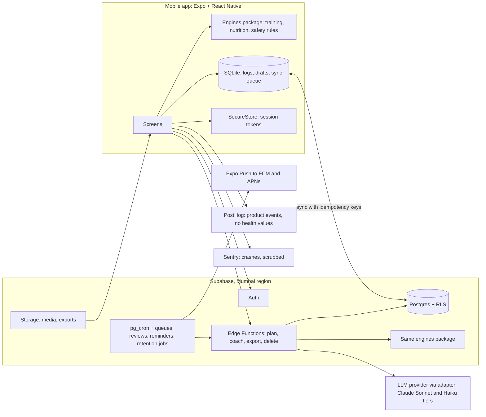

# 11 · Architecture and technology decisions

Facts are tagged with claim IDs from file 02 (T-xx are tech claims, verified 19 October 2026). Versions and prices change; re-check before the build starts.

## 1. System overview

**The key structural decision [REC]:** one pure TypeScript engines package (no I/O, no React) runs on both the phone and the server. This is the Kokum pattern (`app/src/engine`, 48 invariant tests). It means logging, totals, today's session and safety stops work offline, and the server re-validates everything the phone or the model proposes with the same code.

## 2. Stack options compared

| Criterion | A. Expo + Supabase (recommended) | B. Expo + own Node API + managed Postgres | C. Flutter + Firebase | D. Native Swift and Kotlin + own backend |
|---|---|---|---|---|
| Solo-founder speed | High: one language, managed auth, RLS, storage | Medium: more to run | Medium: new language (Dart) for you | Low: two codebases |
| Reuse from Kokum | High: same stack, engine pattern, Supabase schema style | High on the app side | None | None |
| Offline logging | expo-sqlite (T-01) | Same | Firestore offline cache (document model fits logs less well) | Best native control |
| Relational integrity and RLS | Postgres with RLS on every exposed table (T-05) | Postgres, auth in app code | Document DB with security rules | Depends |
| India data region | Mumbai `ap-south-1` selectable (T-03) | Any Mumbai host | Firebase has an India region (not verified here) | Any |
| Lock-in | Medium; Postgres is portable | Low | High | Low |
| Running cost at pilot | Pro plan $25/month (T-04) | Similar or more | Free tier likely enough | Similar |
| Main risk | Edge Function limits: 2 s CPU per request, 400 s wall clock on paid plans (T-05) | You run more infrastructure | Rewrite skills; weaker fit for relational nutrition data | Time |

**Decision [REC]:** Option A for pilot and beta. Move AI orchestration to a small Node service in Mumbai only if Edge Function limits bite. LLM calls are I/O waits, not CPU, so the 2-second CPU limit should hold; that is an assumption to test in week 1 of the build.

## 3. Architecture decision records

| ADR | Decision | Why | Trade-off | Status |
|---|---|---|---|---|
| ADR-01 | Expo SDK 58 (React Native 0.88, New Architecture, which can no longer be turned off from SDK 55) with TypeScript and Expo Router (T-01) | One codebase; file-based routes; every screen deep-linkable | Typed routes are still opt-in beta; native modules need development builds, not Expo Go | REC |
| ADR-02 | Local-first logs in expo-sqlite, with SQLCipher encryption in development builds; SecureStore for tokens only (T-01) | Logging must never wait for the network; Kokum's AsyncStorage stopgap does not scale | SQLCipher is not available in Expo Go | REC |
| ADR-03 | Supabase in Mumbai: Postgres, Auth, Storage, Edge Functions, pg_cron (T-03 to T-05) | Managed, relational, RLS, India region | Provider dependency; SOC 2 report only on Team plan or above | REC |
| ADR-04 | Shared pure-TS engines package with golden tests | Deterministic numbers; same code on phone and server | Must keep the package free of platform APIs | REC |
| ADR-05 | LLM behind an adapter. Primary: Anthropic API directly, Sonnet 5.5 for coach turns, Haiku 5.5 for parsing and classification, structured outputs everywhere (T-06, T-07) | Structured outputs are generally available on the direct API; on AWS Bedrock in Mumbai the 5.5 models run only through global cross-region inference and lack structured outputs (T-08) | Data is processed outside India; needs explicit AI-processing consent (Apple 5.1.2(i), R-15), SPDI transfer conditions until 13 May 2027 and DPDP s.16 after (R-06, R-25); counsel to confirm (file 15) | REC, legal check |
| ADR-06 | Send the LLM only pseudonymous, minimised context: no name, email, date of birth or free-text notes unless needed for the turn | Data minimisation | Slightly less natural replies | REC |
| ADR-07 | Notifications via Expo Push to FCM and APNs, scheduled server-side in the user's timezone; local notifications for rest timers (T-17) | Free; one API | Delivery is best-effort; never rely on push for safety | REC |
| ADR-08 | PostHog for product events with no health values; Sentry for crashes with PII scrubbing (T-20, T-21) | Generous free tiers | PostHog cloud is US or EU only, so events leave India; keep payloads non-sensitive | REC |
| ADR-09 | Media in Supabase Storage plus CDN for pilot; evaluate a video host for beta | Simple | Video transcoding is not built in | OPEN |
| ADR-10 | Subscriptions (launch): Google Play Billing and App Store purchases through RevenueCat (free up to $2,500 monthly tracked revenue, then 1 per cent) (T-18) | Store rules for digital subscriptions; one entitlement API | Store fees apply (file 21) | REC, P2 |
| ADR-11 | Health Connect (Android) and HealthKit (iOS) read-only in beta; Google Fit APIs are being deprecated in 2026 (T-22) | Steps, workouts, weight | Health permissions need store declarations | REC, P1 |
| ADR-12 | Security baseline: OWASP MASVS and MASTG (file 15) | Recognised mobile standard | Mapping work | REC |
| ADR-13 | Admin: Supabase Studio, owner only, MFA, for pilot; small internal web admin for beta with audit logging | No admin build before it is needed | Studio gives broad access; keep to one person | REC |

## 4. Environments and delivery

| Environment | Purpose | Data |
|---|---|---|
| `dev` | Local and preview builds | Synthetic only |
| `staging` | Release candidates, eval runs | Synthetic only |
| `prod` | Pilot, then beta | Real; same safeguards from day one |

- Separate Supabase projects per environment; migrations in version control via the Supabase CLI.
- CI (GitHub Actions): typecheck, lint, unit tests, engine golden tests, RLS policy tests, and the AI evaluation suite whenever a prompt, model or rule changes.
- Builds: EAS Build free tier gives 15 Android and 15 iOS builds a month; EAS Update free to 1,000 monthly active users (T-01). Starter plan $19/month if limits bite.
- Release: internal track (pilot), then Play closed testing and TestFlight (beta).

## 5. Background jobs

| Job | Schedule | Notes |
|---|---|---|
| Weekly review build | User's chosen day, 05:00 local | Engines only; LLM writes the summary text after |
| Reminders | Per user preferences, outside quiet hours | Skips if the action is already done |
| Short-term memory expiry | Hourly | Deletes expired "busy this week" notes |
| Export builder | On request | Signed link valid 24 hours |
| Deletion executor | On request, after grace period | Writes to the deletion ledger |
| Retention sweeper | Daily | Applies table-level retention (file 15) |
| Eval canary | Daily in staging | 50 fixed prompts; alerts on drift |

## 6. Monitoring

| Signal | Tool | Alert |
|---|---|---|
| Crashes, JS errors | Sentry | New issue in prod |
| Edge Function errors and latency | Supabase logs + `model_runs` table | Error rate over 2 per cent over 15 min |
| LLM schema failures, refusals, safety triggers | `model_runs` | Any spike over 2x the 7-day baseline |
| Sync failures | Client events (counts only) | Over 1 per cent of sync attempts in a day |
| Cost | Provider usage plus `model_runs` | Daily spend over budget |
| Backups | Supabase dashboard | Missing daily backup |

## 7. Backups and disaster recovery

| Stage | Backups | RPO (target) | RTO (target) |
|---|---|---|---|
| Pilot and beta | Supabase Pro daily backups, kept 7 days (T-04) | 24 h | 8 h |
| Launch | Point-in-time recovery add-on, about $100/month for 7 days (T-04) | Minutes | 4 h |

- A restore drill every quarter, written up.
- **Deletion ledger:** a minimal table of hashed deleted-user IDs and dates, kept outside user data, re-applied after any restore so restored backups never resurrect deleted accounts.
- Local SQLite on the phone is a second copy of the user's own logs until synced.

## 8. Unit cost of AI [FACT for prices, HYP for usage]

At verified prices (Sonnet 5.5 $2 / $10 and Haiku 5.5 $0.10 / $0.50 per million input / output tokens, T-06) and an assumed 40 coach turns and 30 parse calls per user per month, the model cost is about **$0.45 per user per month** before caching (T-23). Budget **$0.60** to allow for tokenizer and reasoning overhead. File 21 converts this to rupees.
