# 12 · Database and API design

All tables and endpoints are **proposed**; none exist. Postgres on Supabase (file 11). Row-level security is on for every table in an exposed schema (claim T-05).

## 1. Conventions

- Primary keys: `uuid` (v7 for time ordering) except lookup tables.
- Every user-owned table has `user_id uuid not null references auth.users`, `created_at`, `updated_at`, and an RLS policy `user_id = auth.uid()`.
- Quantities always carry an explicit unit column; stored in canonical units (g, ml, kg, s, cm). Display units are a profile setting.
- Timestamps in UTC (`timestamptz`) plus the user's IANA timezone captured at the time of the event (`tz text`), so "which day" never changes when the user travels.
- Status columns are Postgres enums or lookup tables; model output never becomes a status string.
- Soft delete only where history matters (`deleted_at`); account deletion is a hard delete (file 15).
- `client_op_id uuid` on every client-created row, unique per user, for idempotent sync.

## 2. Entity map

```mermaid
erDiagram
  USERS ||--|| PROFILES : has
  USERS ||--o{ CONSENT_RECORDS : grants
  USERS ||--o{ READINESS_ASSESSMENTS : completes
  USERS ||--o{ RESTRICTIONS : has
  USERS ||--o{ GOALS : sets
  USERS ||--|| PREFERENCES : configures
  USERS ||--o{ PLANS : follows
  PLANS ||--o{ PLAN_ITEMS : contains
  PLANS ||--o{ PLAN_CHANGES : logs
  USERS ||--o{ WORKOUT_SESSIONS : performs
  WORKOUT_SESSIONS ||--o{ EXERCISE_SETS : records
  EXERCISES ||--o{ EXERCISE_SETS : used_in
  EXERCISES ||--o{ EXERCISE_MEDIA : shown_by
  EXERCISES }o--|| MOVEMENT_PATTERNS : belongs_to
  USERS ||--o{ MEAL_LOGS : eats
  MEAL_LOGS ||--o{ MEAL_LOG_ITEMS : includes
  FOODS ||--o{ MEAL_LOG_ITEMS : referenced_by
  FOODS ||--o{ FOOD_NUTRIENTS : has
  FOODS ||--o{ FOOD_ALIASES : known_as
  INGREDIENTS ||--o{ INGREDIENT_ALIASES : known_as
  RECIPES ||--o{ RECIPE_ITEMS : made_of
  USERS ||--o{ CHECK_INS : submits
  USERS ||--o{ COACH_MESSAGES : exchanges
  COACH_MESSAGES ||--o{ COACH_ACTIONS : proposes
  COACH_ACTIONS }o--o{ EVIDENCE_CARDS : cites
  USERS ||--o{ SAFETY_EVENTS : triggers
  USERS ||--o{ PROGRESS_ENTRIES : records
  USERS ||--o{ MEMORY_ITEMS : known_about
```



## 3. Tables

### 3.1 Identity, consent, safety

| Table | Key columns | Notes | Retention |
|---|---|---|---|
| `profiles` | `user_id` PK, `display_name`, `birth_year`, `timezone`, `locale`, `units`, `nutrition_mode` (numeric, non_numeric), `coach_tone` | Store birth year, not full date, after the age check | Account life |
| `consent_records` | `id`, `user_id`, `purpose` (enum: core, ai_processing, analytics, crash_reports, reminders, history_personalisation, parse_improvement, human_review_sample), `notice_version`, `granted bool`, `at`, `channel` | Append-only; `ai_processing` checked before every model call | Account life + legal minimum after deletion (counsel to confirm) |
| `readiness_assessments` | `id`, `user_id`, `questionnaire_version`, `answers jsonb`, `disposition` (clear, limited, red_flag) | Restricted: no analytics role access | Account life |
| `restrictions` | `id`, `user_id`, `code` (e.g. `no_deficit`, `intensity_cap_moderate`, `exclude_pattern:knee_flexion_loaded`, `non_numeric_only`), `source` (assessment, pain_report, user), `expires_at` | Read by every engine | Until expired or account deletion |
| `safety_events` | `id`, `user_id`, `type` (red_flag_symptom, pain_report, ed_signal, unsafe_request), `severity`, `context_ref`, `handled_by` (template ID), `reviewed_at`, `reviewer` | Restricted; reviewed in admin queue | 2 years then aggregate (counsel to confirm) |
| `deletion_ledger` | `user_id_hash`, `deleted_at` | Outside user data; re-applied after restores | Indefinite (contains no personal data beyond a hash) |

### 3.2 Goals, preferences, plans

| Table | Key columns | Notes |
|---|---|---|
| `goals` | `id`, `user_id`, `type` (fat_loss, muscle_gain, strength, fitness, mobility, habits, maintenance), `priority` (primary, secondary), `status`, `target jsonb` (bounded schema) | |
| `preferences` | `user_id` PK, `diet_pattern`, `allergens text[]` (hard), `allergen_free_text text[]` (hard, unmapped), `dislikes uuid[]`, `cuisines text[]`, `budget_band`, `cooking_access`, `observances text[]`, `equipment text[]`, `location`, `days_available int[]`, `session_minutes int` | Allergens and dislikes kept in separate columns by design |
| `plans` | `id`, `user_id`, `version int`, `status` (proposed, active, superseded, archived), `starts_on date`, `ends_on date`, `engine_version`, `rule_set_version`, `inputs_hash` | One active plan per user (partial unique index) |
| `plan_items` | `id`, `plan_id`, `date`, `kind` (session, nutrition_target, habit), `ref_id`, `payload jsonb` (validated by schema version), `order` | |
| `plan_changes` | `id`, `plan_id`, `from_version`, `to_version`, `rule_ids text[]`, `reason_text`, `proposed_by` (engine, coach, user), `decision` (accepted, declined, expired), `decided_at` | Explains every change |
| `session_templates` | `id`, `name`, `goal`, `level`, `location`, `blocks jsonb`, `review_status`, `version` | Global, read-only to users |

### 3.3 Training

| Table | Key columns | Notes |
|---|---|---|
| `movement_patterns` | `code` PK (squat, hinge, push_h, push_v, pull_h, pull_v, lunge, carry, core_anti_ext, ...), `joint_load_tags text[]` | Drives pain-aware substitution |
| `exercises` | `id`, `name`, `aliases text[]`, `pattern_code`, `equipment text[]`, `level`, `unilateral bool`, `cues text[]`, `mistakes text[]`, `contraindication_tags text[]`, `review_status`, `reviewed_by`, `reviewed_at`, `version` | Only `review_status = approved` is selectable |
| `exercise_substitutions` | `exercise_id`, `substitute_id`, `reason` (equipment, easier, harder, pain) | Curated, not generated |
| `exercise_media` | `id`, `exercise_id`, `kind`, `uri`, `captions_uri`, `licence_id`, `review_status` | Asset manifest (file 09) |
| `media_licences` | `id`, `vendor`, `scope`, `territory`, `expires_at`, `document_uri` | |
| `workout_sessions` | `id`, `user_id`, `plan_item_id` (nullable), `status` (planned, in_progress, completed, partial, skipped), `started_at`, `ended_at`, `tz`, `feel` (too_easy, right, too_hard), `client_op_id` | Partial unique: one `in_progress` per user |
| `exercise_sets` | `id`, `session_id`, `exercise_id`, `set_index`, `target jsonb`, `reps`, `load_kg numeric(5,1)`, `duration_s`, `effort_rir`, `status` (done, skipped), `logged_at`, `client_op_id` | Unique (`session_id`, `exercise_id`, `set_index`) |

### 3.4 Nutrition

| Table | Key columns | Notes |
|---|---|---|
| `ingredients` | `id` (text slug), `name`, `allergen_tags text[]`, `diet_tags text[]`, `default_unit` | Ingredient dictionary |
| `ingredient_aliases` | `ingredient_id`, `alias`, `lang` (en, hi-Latn, hi-Deva, ...) | "dhaniya", "kothmir", "coriander" all resolve to one row |
| `foods` | `id`, `name`, `kind` (ingredient, dish, packaged), `ingredient_id` (nullable), `preparation` (raw, cooked, fried), `source_id`, `licence_id`, `quality` (measured, computed_from_recipe, user_custom), `review_status` | Dishes computed from recipes carry `quality = computed_from_recipe` |
| `food_aliases` | `food_id`, `alias`, `lang` | |
| `food_nutrients` | `food_id`, `nutrient` (energy_kcal, protein_g, fat_g, carb_g, fibre_g, ...), `per_100g numeric`, `source_version`, `missing bool` | Missing is explicit, never zero |
| `serving_units` | `food_id`, `unit` (katori (bowl), piece (roti, idli and similar), tbsp, tsp, cup, glass, g, ml), `grams`, `basis_note` | "1 katori dal = 150 g (assumption, reviewed)" |
| `nutrition_sources` | `id`, `name`, `publisher`, `version`, `licence`, `url`, `retrieved_at` | Provenance for every value |
| `recipes` | `id`, `user_id` (null = global), `name`, `yield_servings`, `oil_level_default`, `verified bool`, `version` | Quantities per stated yield; scaled at read time |
| `recipe_items` | `recipe_id`, `ingredient_id` or `food_id`, `qty`, `unit`, `optional bool` | Optional ingredients never change a dish's identity |
| `meal_logs` | `id`, `user_id`, `eaten_at`, `tz`, `meal_type`, `source` (search, text_parse, saved_meal, recipe), `client_op_id` | |
| `meal_log_items` | `id`, `meal_log_id`, `food_id` or `recipe_id` + `recipe_version`, `qty`, `unit`, `grams_resolved`, `oil_level`, `estimate_low`, `estimate_high`, `nutrients_snapshot jsonb` | Snapshot so later catalogue edits never rewrite history |
| `parse_audits` | `id`, `user_id`, `input_text`, `parsed jsonb`, `confirmed jsonb`, `model_run_id` | Kokum's parse-accuracy signal; text kept 90 days |

### 3.5 Coaching, memory, evidence

| Table | Key columns | Notes |
|---|---|---|
| `check_ins` | `id`, `user_id`, `date`, `energy`, `minutes_available`, `pain bool`, `client_op_id` | Unique (`user_id`, `date`) |
| `coach_conversations` | `id`, `user_id`, `started_at`, `retention_until` | |
| `coach_messages` | `id`, `conversation_id`, `role`, `content`, `safety_class` (routine, caution, red_flag, out_of_scope), `model_run_id`, `created_at` | Default retention 90 days unless the user opts to keep history |
| `coach_actions` | `id`, `message_id`, `type` (swap_exercise, shorten_session, reschedule_session, log_meal_draft, update_preference, propose_plan_change, show_evidence, escalate_safety), `payload jsonb`, `validation_result`, `status` (proposed, confirmed, rejected, expired, auto_applied) | `auto_applied` only for A1 actions (file 13 §2) |
| `memory_items` | `id`, `user_id`, `kind` (stable_pref, constraint, short_term, feedback), `text`, `structured jsonb`, `source` (user, derived), `expires_at`, `visible bool default true` | Shown on S42; nothing hidden |
| `evidence_cards` | `id`, `version`, `title`, `summary`, `applies_to`, `limits`, `source_citation`, `source_url`, `source_date`, `reviewer`, `reviewed_at`, `next_review`, `status` | Curated corpus for retrieval |
| `rules` | `id` (e.g. `PR-03`), `version`, `description`, `params jsonb`, `evidence_card_ids`, `approved_by`, `approved_at` | Every engine rule is data with a version |
| `model_runs` | `id`, `purpose`, `provider`, `model`, `prompt_version`, `input_tokens`, `output_tokens`, `latency_ms`, `schema_valid bool`, `safety_flags`, `cost_usd`, `created_at` | No message content; links to messages by ID |

### 3.6 Progress, habits, notifications, privacy

| Table | Key columns | Notes |
|---|---|---|
| `progress_entries` | `id`, `user_id`, `metric` (weight_kg, waist_cm, sleep_quality, energy), `value`, `unit`, `measured_at`, `tz`, `source` (manual, health_connect, healthkit), `client_op_id` | Same-day duplicates allowed and visible |
| `habit_definitions` | `id`, `title`, `category`, `review_status` | Curated |
| `habit_logs` | `id`, `user_id`, `habit_id`, `date`, `status` (done, rest, skipped), `client_op_id` | Unique (`user_id`, `habit_id`, `date`) |
| `notification_prefs` | `user_id` PK, `categories jsonb`, `quiet_start`, `quiet_end`, `paused_until` | |
| `device_tokens` | `id`, `user_id`, `platform`, `token`, `last_seen_at`, `status` | Pruned after 60 days unseen |
| `privacy_requests` | `id`, `user_id`, `type` (export, deletion), `status`, `requested_at`, `completed_at`, `artifact_uri` | |
| `audit_events` | `id`, `actor`, `actor_role`, `action`, `target_table`, `target_id`, `at`, `reason` | Admin reads of restricted tables always logged |
| `reports` | `id`, `user_id`, `kind` (wrong_food_data, unsafe_advice, bug, account), `text`, `app_version`, `trace_id`, `status`, `created_at` | Retained 1 year |
| `idempotency_keys` | `key`, `user_id`, `endpoint`, `request_hash`, `response_ref`, `expires_at` | 24 h |

## 4. Authorisation matrix

| Role | User-owned tables | Restricted tables (readiness, safety, restrictions) | Global catalogues | Admin actions |
|---|---|---|---|---|
| `authenticated` user | Own rows only (RLS) | Own rows, read and limited write through functions | Read approved rows | None |
| `service` (Edge Functions) | Scoped by the caller's verified user ID | Via security-definer functions only | Read | None |
| `content_reviewer` | None | None | Read and write drafts; approve | Approve content |
| `safety_reviewer` | None | Read with audit event per read | Read | Mark events reviewed |
| `owner` | Break-glass only, audited | Break-glass only, audited | Full | Full |

Analytics roles never get access to restricted tables. Tests in CI assert every RLS policy (user A cannot read or write user B's rows, for every table).

## 5. API

### 5.1 Pattern

| Kind of operation | Path | Why |
|---|---|---|
| Simple owned reads and logs (meal logs, sets, habits, progress, check-ins) | Direct to Postgres through Supabase client, protected by RLS and DB constraints | Fast, offline sync-friendly |
| Anything with business rules (plans, coach, targets, safety, export, deletion) | Edge Functions under `/v1/*` | Engines and validation run server-side |

### 5.2 Common rules

- `Authorization: Bearer <session JWT>`; the user ID always comes from the token, never the body.
- `Idempotency-Key` header required on every POST that creates or changes state.
- Request and response bodies validated against versioned JSON Schemas; unknown fields rejected.
- Errors use one shape: `{ "error": { "code": "VALIDATION_ERROR", "message": "...", "fields": {...}, "trace_id": "..." } }`.
- Codes: `VALIDATION_ERROR`, `UNAUTHENTICATED`, `FORBIDDEN`, `NOT_FOUND`, `CONFLICT`, `RATE_LIMITED`, `SAFETY_REVIEW_REQUIRED`, `RESTRICTED_BY_ELIGIBILITY`, `DEPENDENCY_UNAVAILABLE`, `INTERNAL_ERROR`.
- Rate limits: coach 30 turns per hour per user; plan regeneration 5 per day; parse 60 per hour.
- Async work returns `202` with `{ request_id, status: "pending" }` and a status endpoint.

### 5.3 Endpoints

| Method and path | Purpose | Notes |
|---|---|---|
| `POST /v1/onboarding/complete` | Validate onboarding, store readiness, derive restrictions, start plan build | Returns `202` |
| `POST /v1/assessments` | Re-take readiness | Recomputes restrictions; may invalidate the active plan |
| `POST /v1/plans` | Build or regenerate a plan | `202`; bounded to 5 a day |
| `GET /v1/plans/current` | Active plan with items and reasons | |
| `POST /v1/plans/{id}/accept` | Accept proposed plan | Idempotent |
| `POST /v1/plans/{id}/changes/{changeId}/decision` | Accept or decline a proposed change | |
| `POST /v1/sessions/{id}/shorten` | Shorten today's session to N minutes | Engine output only |
| `POST /v1/sessions/{id}/swap` | Swap an exercise | Returns allowed substitutes; never invents |
| `POST /v1/pain-reports` | Report pain | May return `SAFETY_REVIEW_REQUIRED` with the stop template |
| `POST /v1/meals/parse` | Parse free text to draft items | Draft only; nothing saved |
| `GET /v1/foods/search?q=` | Catalogue search with aliases | Allergens flagged, not hidden, for logging |
| `GET /v1/targets/today` | Today's nutrition targets or plate guidance | Engine output with reasons |
| `POST /v1/coach/messages` | Coach turn | Streams text; actions delivered as validated JSON at the end |
| `POST /v1/coach/actions/{id}/confirm` | Confirm a proposed action | Re-validated at confirm time |
| `GET /v1/me/memory` and `DELETE /v1/me/memory/{id}` | What my coach knows | |
| `GET /v1/reviews/weekly/latest` | Weekly review | |
| `POST /v1/privacy/export` | Request export | `202`; link valid 24 h |
| `POST /v1/privacy/deletion` | Request deletion | Requires recent re-auth |
| `PUT /v1/notifications/prefs` | Update reminders | |
| `POST /v1/reports` | Report wrong food data, unsafe advice or a bug | |

### 5.4 Example: coach turn response

```json
{
  "message_id": "uuid",
  "text": "Your knee felt sore on squats, so today swaps them for a hip-dominant move.",
  "safety_class": "routine",
  "actions": [
    {
      "action_id": "uuid",
      "type": "swap_exercise",
      "payload": { "session_id": "uuid", "from": "ex_goblet_squat", "to": "ex_glute_bridge" },
      "requires_confirmation": true,
      "reason_rule_ids": ["TR-07"],
      "evidence_card_ids": []
    }
  ],
  "sources": []
}
```

The server rejects the action if `ex_glute_bridge` is not an approved substitute for that exercise given the user's restrictions; the user then sees the deterministic alternatives instead.

## 6. Sync design (phone to server)

1. Every local write goes to SQLite with a `client_op_id` and `sync_state = pending`.
2. The sync worker sends pending rows in order; the server upserts on (`user_id`, `client_op_id`), so retries never duplicate.
3. Logs (sets, meals, habits, progress) are append-mostly; same-row edits use `updated_at` with last-write-wins and keep the losing version in a conflict list (S44).
4. Plans and preferences are server-authoritative; the phone holds a cached copy and proposes changes through endpoints.
5. A failed sync leaves local data untouched and visible as failed.

Unlike Kokum, conflicts are surfaced to the user rather than silently resolved, because a lost workout or meal is visible harm here (Kokum lists "no conflict surface" as a known gap).
