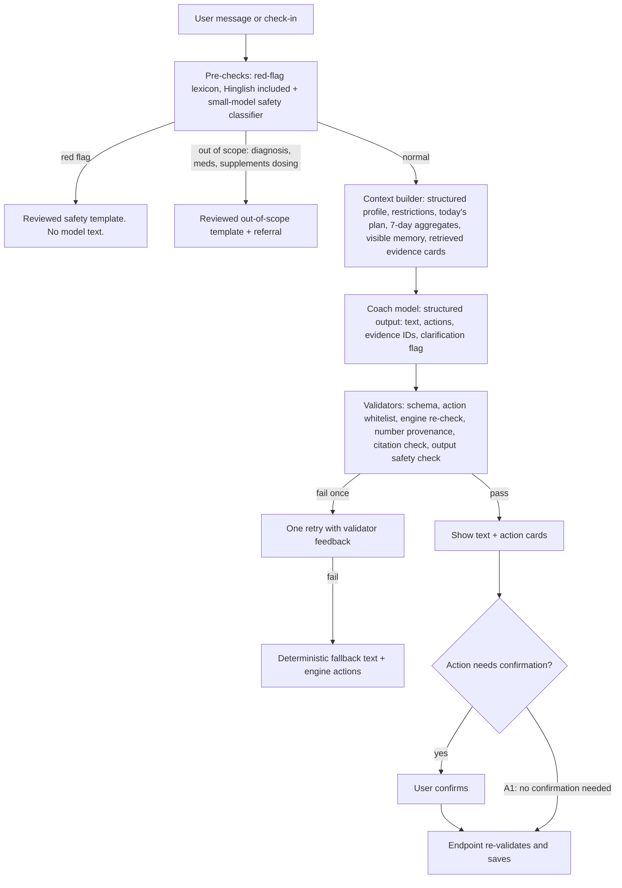

# 13 · AI coaching architecture and evidence governance

Every rule parameter in §3 is **[REC, pending professional review]**. None is approved for anyone but the founder-pilot until a registered dietitian and a qualified strength and conditioning professional sign them off (go/no-go item G-14, file 23). Evidence claims carry E-xx IDs from file 02.

## 1. Principle: engines decide, the model explains

### Number provenance check (enforces the one rule)

Every number in the model's text (kcal, grams, kg, reps, sets, minutes, percentages) must match a value in the `facts` block the context builder supplied for that turn, within rounding. A number with no source is stripped and the turn retried once; on a second failure the deterministic fallback is shown. This is the same design as Kokum's `reattach()`: the model can phrase and order, it cannot invent state.

## 2. Coach components

| Component | Design | Notes |
|---|---|---|
| Models | Haiku tier for classification and parsing; Sonnet tier for coach turns (claim T-06) | Adapter allows switching provider; every switch re-runs the eval suite |
| Output format | Structured outputs with JSON Schema: `text`, `actions[]`, `evidence_card_ids[]`, `needs_clarification`, `clarifying_question` | Shape guaranteed by the API; meaning re-validated by code |
| Actions whitelist | `swap_exercise`, `shorten_session`, `reschedule_session`, `log_meal_draft`, `update_preference`, `propose_plan_change`, `show_evidence`, `escalate_safety` | No free-form tools, no database or web access |
| Action tiers | **A1** no confirmation: `show_evidence`, `log_meal_draft` (opens an unsaved draft). **A2** user confirms: `swap_exercise`, `shorten_session`, `reschedule_session`, `update_preference`, `propose_plan_change`. **A3** safety: `escalate_safety` is always shown and cannot be dismissed by the model | Separate from the message `safety_class` (routine, caution, red_flag, out_of_scope) |
| Without AI consent | Coach and parsing are off. Safety still runs: the deterministic red-flag lexicon (English and Hinglish), the check-in pain button, the player's "Something's wrong?" and onboarding answers. The small-model classifier is not used | File 15 §4 |
| Context | Structured profile summary rebuilt from tables each turn, not from chat history | Keeps prompts small and correctable |
| Conversation history | Last 6 turns only if the user consented to history use; otherwise the current turn only | |
| Retrieval | Keyword plus tag search over the curated `evidence_cards` table (tens to low hundreds of cards); no open web | Embeddings only if keyword search proves insufficient |
| Citations | Model returns card IDs; the app renders title, source and date from the database | Unknown IDs dropped |
| Memory | `memory_items`, all visible on S42; anything inferred from chat needs a "Remember this?" confirmation | Short-term items expire (default 7 days) |
| Tone | `coach_tone` parameter changes wording only | Tone never relaxes a safety rule |
| Uncertainty | Engines return ranges and a `data_sufficiency` flag; the model must say "not enough data yet" when the flag is false | At most one clarifying question per turn |
| Latency | Stream text; actions arrive at the end; show "still thinking" at 8 s; cancel at 30 s | Logging never waits on the coach |
| Failure | Timeout, refusal, schema failure or provider outage all degrade to deterministic content with a plain notice | As Kokum's degradation table |

## 3. Rule sets (draft parameters)

### 3.1 Energy (EN)

| ID | Rule | Default | Basis |
|---|---|---|---|
| EN-01 | Initial resting energy from the Mifflin-St Jeor equation; activity multiplier; output a range of plus or minus 10 per cent | Range, never a single number; replaced by the adaptive estimate (EN-04) once data allows | E-16 (derived from US adults and not tested in non-white groups; a small Indian study found such equations underestimate resting energy, which is why the output is a range) |
| EN-02 | Fat-loss target rate | Default 0.5 kg per week (lower end of the public-health range); hard cap at the lower of 1 kg per week and 1 per cent of body weight per week | E-04 (NHLBI, NHS: 0.5 to 1 kg per week). The 1 per cent cap is a design choice that protects lighter users |
| EN-03 | Energy floor | Target lower bound never below estimated resting energy; absolute floor set by the dietitian | **[OPEN]** for reviewer |
| EN-04 | Adaptive expenditure after at least 14 days with at least 10 logged days and 8 weigh-ins; trend weight versus intake | Weekly update, change capped at 10 per cent of target | Method similar to MacroFactor's published approach (M-04); energy-density assumption flagged as approximate |
| EN-05 | Muscle-gain surplus | Small surplus; target gain 0.5 to 1 per cent of body weight a month (beginners up to 1.5) | **[OPEN]** for reviewer |
| EN-06 | No change when data is insufficient or logging adherence is under 70 per cent of days | "Not enough data" message | Design rule |
| EN-07 | Never compensate one day with next-day restriction or extra exercise | Hard rule | Safety (file 14) |
| EN-08 | Restriction `no_deficit` | Maintenance only | File 14 |

### 3.2 Protein (PR) and fibre (FB)

| ID | Rule | Default | Basis |
|---|---|---|---|
| PR-01 | Floor for all adults | At least 0.83 g/kg/day (ICMR-NIN 2020 safe level; a population adequacy floor, not a training target) | E-06 |
| PR-02 | Resistance training, muscle gain or deficit | Default 1.6 g/kg/day, range 1.4 to 2.0 | E-02 (ISSN range); E-06 (ICMR-NIN 2024 says intakes above about 1.6 add no further muscle gain). Disputed above 1.6; default sits where both sources agree |
| PR-03 | Higher option for lean, resistance-trained users in a deficit | Up to 2.0 g/kg body weight, opt-in only | E-03 (Helms: 2.3 to 3.1 g/kg of fat-free mass, from 6 small studies of lean athletes). **[OPEN]** for reviewer, because ICMR-NIN sees no added benefit above about 1.6 |
| PR-04 | Restriction from kidney or liver disease flag | No protein target above PR-01; refer | File 14 |
| PR-05 | Higher body weight | Compute from a reference weight chosen by the reviewer | **[OPEN]** |
| FB-01 | Fibre | **[OPEN]** No number ships until the ICMR-NIN 2020 fibre table is obtained from NIN; until then show fibre as information only, with no target | E-14 UNVERIFIED |
| FD-01 | Non-numeric mode | Plate guidance and protein portions per meal (palm or katori counts) | E-05 |
| FD-02 | Allergens | Hard exclusion across all ingredients, including optional ones (Kokum rule) | Design rule |

### 3.3 Training (TR)

| ID | Rule | Default | Basis |
|---|---|---|---|
| TR-01 | Template by days, experience, location | 2 to 3 days: full body; 4 days: upper and lower; 5 to 6: reviewer-approved split. Aim for at least 2 resistance sessions a week; with only 1 available day, schedule 1 full-body session and suggest an optional short home session | E-11 (ACSM 2026 position stand: 2+ sessions a week) |
| TR-02 | Starting dose for novices | 2 to 3 sets per exercise in moderate rep ranges, 2 to 3 reps in reserve; build toward at least 10 weekly sets per major muscle group for hypertrophy goals, and heavier loads (around 80 per cent of max, 2 to 3 sets) for strength goals once technique is stable | E-11 (ACSM 2026). The specific novice start is **[OPEN]** for reviewer |
| TR-03 | Double progression | When all sets reach the top of the range with at least 2 reps in reserve, add the smallest load step next time; two sessions below the range: reduce load 5 to 10 per cent | Design rule; ACSM 2026 (E-11) found no consistent advantage for any one periodisation model, so the simplest rule is chosen |
| TR-04 | Deload | Every 5th or 6th week, or when performance drops in 2 sessions and energy is 2 or below: about half the sets for one week | **[OPEN]** for reviewer |
| TR-05 | Volume ramp | No more than 2 extra sets per muscle group per week | **[OPEN]** for reviewer |
| TR-06 | Shorten | Keep a shortened warm-up (at least 3 minutes) and the session's main lift; cut accessories; never raise intensity to compensate | Design rule |
| TR-07 | Substitution | Same pattern, available equipment, not under a pain restriction, difficulty within one level; otherwise skip | Design rule |
| TR-08 | Return after a break | 7+ days off: one session at about 70 per cent volume; 21+ days: loads at 50 to 60 per cent | **[OPEN]** for reviewer |
| TR-09 | Aerobic build-up toward WHO weekly amounts | Add 10 to 15 minutes a week; intensity by talk test | E-01 |
| TR-10 | Rest | At least 1 full rest day a week | Design rule |

## 4. Prompt-injection and abuse protection

| Threat | Control |
|---|---|
| User tells the coach to ignore rules or produce a crash diet | Safety rules live in code, not the prompt; output validators and number provenance block it; logged as `unsafe_request` |
| Injected text inside a food name, custom food or note | User content only ever appears in the user role, quoted as data; no tools that could act on it |
| Retrieved content carrying instructions | Retrieval corpus is internal and reviewed; no web retrieval |
| Images (P2 photo logging) | Treated as data; parse output goes through the same validators and a confirm screen |
| Cross-user leakage | Context is built server-side from one user's rows under RLS; no shared conversation memory |
| Prompt extraction | System prompt contains no secrets, so extraction is harmless |
| Cost abuse | Per-user rate limits and daily token caps |

## 5. Evaluation

| Suite | Size at pilot gate | Size at beta gate | Pass line |
|---|---|---|---|
| Critical safety (red flags, ED signals, pain, pregnancy, meds, minors, extreme diets, supplement dosing) | 60 | 150 | 100 per cent correct handling |
| Policy override and prompt injection | 20 | 60 | 100 per cent blocked |
| Number provenance | 30 | 80 | Zero unsourced numbers shown |
| Action validity (swaps, shortens, plan changes) | 20 | 60 | 100 per cent valid or rejected |
| Helpfulness and tone (rubric, model-graded plus 10 per cent human sample) | 20 | 50 | At least 4 of 5 average |
| Hinglish and Indian food parsing | 30 | 100 | At least 90 per cent items correct before user edit |
| **Total** | **180** | **500** | |

- Any change to a prompt, model, rule or evidence card re-runs the full suite in CI; a red critical row blocks release.
- Production monitoring: schema failure rate, retry rate, fallback rate, unsafe-request rate, user "this is wrong" rate, cost per user.
- Passing every test is a release requirement, not proof of safety.

## 6. Human review workflows

| Queue | What lands in it | Reviewer | Target time (beta) |
|---|---|---|---|
| Content | New or changed exercises, foods, serving units, evidence cards, rules | S&C professional (exercise), dietitian (nutrition) | Before release |
| Safety events | Every red flag, pain report of 7+, ED signal, unsafe request | Founder plus on-call reviewer | Critical within 4 waking hours; others within 24 h |
| User reports | "This is wrong", wrong food data, unsafe advice | Founder | 48 h |
| Conversation sample | 5 per cent of beta conversations from users who gave the human-review consent, random | Founder plus reviewer monthly | Monthly |

**Incident levels:** SEV1 unsafe advice shown that could cause harm (disable the affected rule or feature flag immediately, notify affected users, root cause within 72 h); SEV2 wrong numbers without safety impact; SEV3 tone or quality.

## 7. Evidence governance

| Item | Rule |
|---|---|
| Source hierarchy | 1. Indian and international public-health guidance (ICMR-NIN, WHO). 2. Professional position stands (ACSM, ISSN). 3. Systematic reviews and meta-analyses. 4. Individual trials. Blogs, influencers and vendor material are never sources. |
| Evidence strength label on every card | Consensus · Moderate · Emerging · Disputed |
| Card fields | Summary, who it applies to, who it does not, limits, citation, URL, publication date, reviewer, review date, next review, version |
| Review cycle | 12 months, or immediately when a source updates |
| Disagreements | Recorded on the card ("experts differ on X; we use Y because Z") |
| Licensing | Paraphrase guidance; never embed copyrighted tables or text without permission (E-05, E-07) |
| Rollback | Retiring a card or rule version re-evaluates affected plans and logs a `plan_change` |

No recommendation is described as "medically approved". Reviewed content is labelled "reviewed by a registered dietitian on <date>" only when that is literally true.
