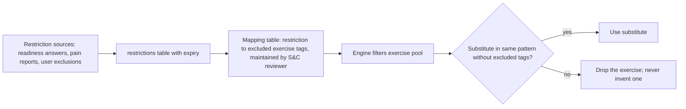

# 14 · Safety and regulatory risk register

The app is a wellness coach, not a medical service. Every template and threshold here is **[REC, pending professional review]**: a registered dietitian, a qualified strength and conditioning professional and (for the crisis and ED templates) a mental-health professional must sign them off before anyone but the founder uses the app. Legal items are fact-finding, **not legal advice**; counsel must confirm them (file 22).

## 1. Risk taxonomy

| Code | Category | Examples |
|---|---|---|
| S1 | Physical harm from exercise | Cardiac event during exertion, acute injury, overuse, training through pain |
| S2 | Nutritional harm | Excessive restriction, allergen exposure, high protein with kidney disease, low blood sugar on diabetes medicines |
| S3 | Psychological harm | Eating-disorder reinforcement, body-image distress, shame, compulsive tracking |
| S4 | Information harm | Hallucinated advice, wrong food data, false precision, outdated guidance |
| S5 | Privacy and security harm | Breach, cross-user leakage, health data in analytics or ads |
| S6 | Legal and regulatory | Drift into medical-device territory, misleading claims, data-law breach, store rejection |
| S7 | Commercial integrity | Supplement bias, dark patterns, manipulative retention |

## 2. Risk register

Likelihood and impact are pre-control estimates. Residual is after controls. Owner "You" means the founder until a team exists.

| ID | Risk | Cat | Likelihood | Impact | Controls | Residual | Owner | Verified by |
|---|---|---|---|---|---|---|---|---|
| RK-01 | Red-flag symptom during a workout is ignored by the app | S1 | Low | Severe | Lexicon plus classifier on check-in, player and coach; S36 stop; cannot be dismissed by swipe; logged and reviewed | Low | You + S&C reviewer | EC-50; safety eval |
| RK-02 | User trains through injury pain | S1 | Medium | High | Pain flow; pattern flags; substitutions; never "push through" | Low | You + S&C reviewer | EC-54 |
| RK-03 | Excessive training load or no recovery | S1 | Medium | Medium | Volume ramp cap, deloads, mandatory rest day, return-after-break rule | Low | S&C reviewer | TR golden tests |
| RK-04 | Calorie target too low | S2 | Medium | High | Floors (EN-03), rate caps (EN-02), weekly change cap (EN-04), no single-day compensation (EN-07), reviewer sign-off | Low | Dietitian | EN golden tests |
| RK-05 | Allergen in a suggestion | S2 | Low | Severe | Hard exclusion across all ingredients; free-text allergies treated as hard; validator on model output; cross-contamination disclaimer on restaurant and packaged items | Low | You + dietitian | EC-44 |
| RK-06 | High protein target for someone with kidney disease | S2 | Low | High | R4 flag sets PR-04 restriction | Low | Dietitian | F-04 tests |
| RK-07 | Low blood sugar from deficit or fasted training on diabetes medicines | S2 | Low | High | R5 flag: no deficit, no fasted training suggestions | Low | Dietitian | F-04 tests |
| RK-08 | App reinforces disordered eating | S3 | Medium | Severe | R9 and behavioural signals switch to ED-aware mode; numbers hidden; supportive template; resources; no streaks; non-numeric mode for anyone | Medium | You + MH reviewer | EC-51, EC-55 |
| RK-09 | Body-image harm from copy or imagery | S3 | Medium | Medium | Copy rules (§7); no before-and-after; weight optional | Low | You | Copy review |
| RK-10 | Model invents advice or numbers | S4 | Medium | High | Engines decide; number provenance; validators; curated evidence only | Low | You | EC-41 to EC-43 |
| RK-11 | Wrong food nutrient values | S4 | Medium | Medium | Sourced values only; missing shown as missing; reviewer checks; user correction; parse audits | Low | Dietitian | EC-32 |
| RK-12 | Photo or text estimates presented as precise | S4 | Medium | Medium | Ranges by default; RangeValue component is the only way to render estimates | Low | You | F-15 tests |
| RK-13 | Cross-user data leak | S5 | Low | Severe | RLS on every table, tests per table, token-derived identity | Low | You | EC-80, EC-81 |
| RK-14 | Health data sent to analytics or ad SDKs | S5 | Low | High | No ad SDKs; event dictionary with no health values; consent-gated analytics | Low | You | Event schema tests |
| RK-15 | LLM provider retains or misuses data | S5 | Low | Medium | Minimised pseudonymous context; provider terms (no training on API data; retention up to 30 days, T-07); seek zero-retention before launch | Low | You | Vendor review |
| RK-16 | Product drifts into medical-device functionality | S6 | Medium | High | Explicit non-goals; out-of-scope templates; intended-use statement; counsel review before any feature touching conditions | Low | You + counsel | Feature review checklist |
| RK-17 | Misleading marketing or in-app claims | S6 | Medium | High | Banned-claims list (§7); every claim substantiated; counsel review of store listing | Low | You + counsel | Copy review |
| RK-18 | Data-law non-compliance at launch | S6 | Medium | High | File 15 mapping; counsel review; notice, consent, rights, breach plan | Medium until counsel review | Counsel | G-16, G-24 |
| RK-19 | Store rejection (health data, account deletion, declarations) | S6 | Medium | Medium | Store policy mapping (§9); in-app deletion; privacy policy; health declarations | Low | You | Pre-submission checklist |
| RK-20 | Supplement or affiliate bias | S7 | Low | Medium | No supplement recommendations; no affiliate revenue | Low | You | Policy |
| RK-21 | Manipulative retention | S7 | Medium | Medium | No streak-loss, guilt or fear copy; notification caps | Low | You | Guardrails (file 17) |
| RK-22 | Self-harm or suicidal statement goes unanswered | S3 | Low | Severe | Crisis lexicon plus classifier; crisis template with helplines; coaching stops that turn; event reviewed | Low | You + MH reviewer | Safety eval |
| RK-23 | Minor uses the app | S6 | Low | High | Age gate; mid-use disclosure locks the account and deletes data | Low | You | F-02, EC tests |

## 3. Escalation rules

| Trigger (any channel: check-in, player, coach, onboarding) | Response | Logging | Follow-up |
|---|---|---|---|
| Chest pain or pressure; fainting; severe breathlessness; palpitations with dizziness; sudden weakness, numbness or drooping on one side; confusion; sudden severe headache | **Stop.** Full-screen S36: "Stop exercising now. If this is happening now, call 112 (emergency) or 108 (ambulance)." (claim R-22) No diagnostic questions. "I'm OK now" leads to rest-day mode, not back into the workout | `safety_events`, critical | Reviewed within 4 waking hours; next session requires the user to confirm they have been checked by a doctor |
| Self-harm or suicidal statements | Crisis template: Tele-MANAS 14416 or 1-800-891-4416 (free, 24x7) and 112 for immediate danger (claim R-22); no coaching content that turn | Critical | Reviewed within 4 waking hours |
| Pain 7 to 10, sharp or stabbing pain, swelling, a "pop", numbness or tingling down a limb | End session; recommend assessment by a doctor or physiotherapist; flag the region | High | 7-day pattern exclusion; re-check prompt |
| Pain 4 to 6 during an exercise | Stop that exercise; offer an alternative for a different region or end; flag pattern 7 days | Medium | If it persists 7+ days or worsens, recommend a physiotherapist |
| Mild, familiar post-exercise muscle soreness | Explain soreness versus pain (reviewed card); option to lighten the session | Low | None |
| Light-headedness or shakiness during a deficit or fast | Stop and rest; if on diabetes medicines, follow the plan their doctor gave them; suggest checking with a doctor; no deficit until re-screen | High | Re-screen prompt |
| Pregnancy disclosed | Pause the plan; apply pregnancy restriction set; explain | High | Re-screen after the user updates status |
| New diagnosis, medicine or surgery disclosed | Limited mode until re-screen | Medium | Re-screen prompt |
| Under-18 disclosed | Lock the account; delete data per policy; explain | High | None |
| Request for diagnosis, medicines, supplement or hormone dosing, steroids or other performance drugs | Out-of-scope template; refer to a doctor or registered dietitian | Low | None |
| Request for an extreme diet (below floors, multi-day fasts, purging, laxatives, dehydration for weight cuts) | Decline; supportive template; offer non-numeric mode | Medium | ED-signal counter |
| ED signals (R9 yes, purging or compensation language, distress about food, repeated deletion of logs) | ED-aware mode offered or applied; resources (no national eating-disorder helpline was found in India, so the template points to Tele-MANAS 14416 and to a doctor or registered dietitian; claim R-22); no numbers in the reply | High | Reviewed within 24 h |

## 4. Exercise contraindication workflow

| Restriction | Excluded tags (examples, reviewer to finalise) |
|---|---|
| `intensity_cap_moderate` (R4, R6) | heavy (around 80 per cent of max or above), maximal sprints, high-intensity intervals, heavy breath-holding lifts |
| `region:knee` (R8 or pain) | loaded deep knee flexion, jumping and landing |
| `region:lower_back` | loaded spinal flexion, heavy hinge, high-impact |
| `region:shoulder` | overhead pressing, loaded end-range shoulder positions |
| `pregnancy` | All programming in MVP (general education only) |

## 5. Higher-risk groups

| Group | MVP handling | Possible future pathway |
|---|---|---|
| Under 18 | Excluded | None planned |
| Pregnant or within 12 months postpartum | Logging and reviewed education only | Programme designed and reviewed by a specialist |
| Heart, kidney or liver disease; any diabetes (insulin or sulfonylureas add no fasted training); blood-pressure or heart-rhythm medicine; told by a doctor to limit activity | Limited mode (file 08 §4): education and logging until medical clearance is confirmed, then light-to-moderate training, no deficit, PR-04 | Clinician-cleared pathway with documented clearance |
| On weight-loss medicine | Limited mode (file 08 §4) | Pathway reviewed with clinicians (muscle preservation focus) |
| Current or past eating disorder | Non-numeric only; resources | Only with a specialist partner, if ever |
| Recent injury or surgery | Region exclusions; recommend physiotherapy | Return-to-training templates reviewed by a physiotherapist |
| Disability | Equipment and pattern choices; accessible UI | Adaptive programmes with specialist review |
| Older adults (65+) | Allowed; screening applies; balance work recommended | Reviewed older-adult templates |

## 6. Supplement policy

1. The app never recommends, doses or links to supplements, hormones or performance drugs.
2. Reviewed educational cards may say: food first; supplements are not required to reach targets; talk to a doctor or registered dietitian before starting one; supplements sold in India cannot legally claim to treat, cure or prevent disease (claim E-15).
3. Protein-target suggestions always use foods first and show food-only ways to reach the target.
4. No supplement affiliate links, sponsorships or ads.

## 7. Claims and copy rules

**Never say:** cure, treat, reverse (any condition), guaranteed, "lose X kg in Y days", clinically proven (unless a specific study supports the specific claim), doctor-approved, medically approved, burns fat (for a food or exercise), detox, "AI nutritionist" or "AI doctor".

**Always:** state that this is a wellness coach and not medical advice in onboarding and the help centre; substantiate every marketing claim with a file reference; label estimates as estimates; say "reviewed by a registered dietitian on <date>" only when literally true.

## 8. Emergency handling details

- Emergency guidance text is fixed, reviewed and shown from local code (works offline).
- The app never asks diagnostic follow-up questions after a red flag.
- The app does not contact anyone automatically and does not collect location.
- After a red flag, ordinary workouts stay paused until the user confirms they have been checked.

## 9. Legal and store-policy landscape (fact-finding, not legal advice)

Dates are for the base case where M0 starts on 26 October 2026 (file 19): pilot from about March 2027, beta about May to June 2027.

| ID | Rule | What it says (verified) | When it bites us | Product implication |
|---|---|---|---|---|
| R-01, R-03 | DPDP Act 2023 and DPDP Rules 2025 | Rules notified 13 November 2025 (G.S.R. 846(E)). Board provisions immediate; consent-manager rules from 13 November 2026; notice, consent, security, breach, rights, cross-border and penalty provisions from **13 May 2027**. Penalty caps by breach type: up to ₹250 crore for failing to take reasonable security safeguards, ₹200 crore for breach-notice failures or children's obligations, ₹150 crore for Significant Data Fiduciary duties, ₹50 crore for other breaches | Beta straddles 13 May 2027; launch is fully covered | Build notice, consent, rights, security and breach handling into the MVP, not later |
| R-02 | DPDP child definition | Under 18 is a child; verifiable parental consent; no tracking, behavioural monitoring or targeted ads aimed at children | From 13 May 2027 | Keep the 18+ age gate; lock and delete on any under-18 disclosure |
| R-04 | Breach notification | Tell affected users without delay; report to the Board without delay, with a detailed report within 72 hours | From 13 May 2027 | Incident runbook in file 15 §8 |
| R-05 | Log retention | Rules require keeping certain logs and processing data for at least one year for security purposes, including after account deletion; the 3-year inactivity erasure applies only to large e-commerce, gaming and social platforms | From 13 May 2027 | Reconcile with our deletion promises (file 15 §3a, Q-33) |
| R-06 | Sensitive data | The DPDP Act has no sensitive category. Until 13 May 2027 the IT Act's SPDI Rules 2011 apply and treat health conditions and medical history as **sensitive personal data** | **Now, through pilot and beta prep** | Written consent, published privacy policy and reasonable security practices from the pilot onward (Q-34) |
| R-25 | Cross-border transfer | Transfers allowed except to countries the government restricts by notification; no list found; applies from 13 May 2027 (SPDI transfer conditions before that) | Pilot onward | Disclose the LLM provider and location; counsel to confirm (Q-23) |
| R-07 | CCPA Guidelines for Prevention of Misleading Advertisements and Endorsements for Misleading Advertisements, 2022 (9 June 2022) | No exaggerated scientific validity; factual claims must be substantiated on demand; cite source and date of research; endorsers must genuinely use the product; disclose material connections | Any marketing | Substantiation file for every claim; endorsers must use the app |
| R-08 | ASCI codes | Special care with ads aimed at people with obesity; health influencers must state relevant qualifications (2025 addendum); no AI-generated testimonials or AI before-and-after weight-loss images; synthetic influencers labelled | Any marketing | No AI transformation visuals; only qualified health creators |
| R-09 | Drugs and Magic Remedies Act 1954 | Obesity is in the Schedule; bans ads for any "drug" (any article other than food meant to affect body structure or function) claiming to treat or prevent it | Any marketing | Never position the app or any partner product as treating or preventing obesity |
| R-10 | CDSCO Medical Devices Rules 2017 and 2026 software guidance | Software is classified by intended use; the 2026 guidance excludes software "merely intended for general wellness"; disease references or disease management take it out of the wellness exclusion | Always | Intended-use statement: general fitness and wellness for healthy adults; no disease claims (Q-24) |
| R-11 | Telemedicine Practice Guidelines 2020 | Cover registered medical practitioners only; silent on dietitians and fitness coaches | Only if a doctor feature is added | Coaches never diagnose or prescribe; any doctor consult must follow the guidelines |
| R-12 | Google Play Health apps declaration and Health Content and Services policy | Declaration mandatory for every app with a published track, including test tracks (since 31 August 2024); non-medical apps must state in the store description that the app is not a medical device and does not diagnose or treat; remind users to consult a professional; privacy policy in-app and on the listing | First Play test track | Declaration and listing wording before the pilot's Play internal track |
| R-13 | Health Connect permissions | Approved use cases only; justification per permission; no ads, sale or broker transfer; encryption required | Beta (Health Connect is P1) | Minimal data types; contract terms with the LLM vendor forbid onward use |
| R-14 | Google Play service fee | 15 per cent for auto-renewing subscriptions in India; user-choice billing cuts it by 4 points (about 11 per cent) with extra compliance | Launch | File 21 models 15 per cent |
| R-15 | Apple App Store Review Guidelines | 1.4.1: health apps that could give inaccurate data get extra scrutiny; disclose methodology behind accuracy claims and remind users to check with a doctor. 5.1.2(i): disclose sharing with third parties **including third-party AI** and get explicit permission first. 5.1.3: health data never for ads, marketing or data mining; no personal health information in iCloud | Pilot (TestFlight) onward | Separate, explicit AI-processing consent (file 15 §4); methodology pages for estimates |
| R-16 | Apple commission | 30 per cent in a subscriber's first year, 15 per cent after; Small Business Program 15 per cent from day one (up to US$1M proceeds) | Launch | Enrol in the Small Business Program |
| R-17 | Apple account deletion | Apps that support account creation must offer account deletion in the app (5.1.1(v)) | Pilot onward | F-21 |
| R-18 | GST | Online information services (heading 9984) at 18 per cent; gyms and physical well-being services (99972) cut to 5 per cent from 22 September 2025; which applies to an app subscription is a classification question | Launch | Model 18 per cent; accountant to confirm (Q-28) |
| R-19 | Accessibility | RPwD rules (2023 amendment) point apps to IS 17802; enforceability contested; draft 2026 amendment would require conformance plus a published conformance report | Launch | Build to IS 17802 and WCAG 2.2 AA; budget an audit |
| R-20 | ICMR Ethical Guidelines for Application of AI in Biomedical Research and Healthcare (2023) | Advisory, not law | Always | Use as the benchmark for the AI governance in file 13 |

**Not checked yet (counsel):** CCPA dark-pattern guidelines 2023 and the E-Commerce Rules 2020 for subscription and cancellation flows; the NCAHP Act 2021 if a dietitian feature is added; whether DPDP periods run from 13 or 14 November 2025; whether the 18-month window was shortened (a January 2026 proposal was found, no notified amendment).

